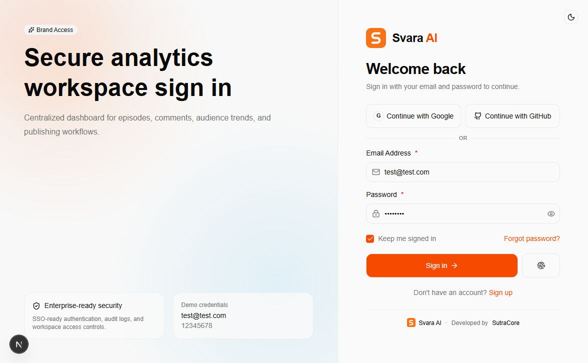
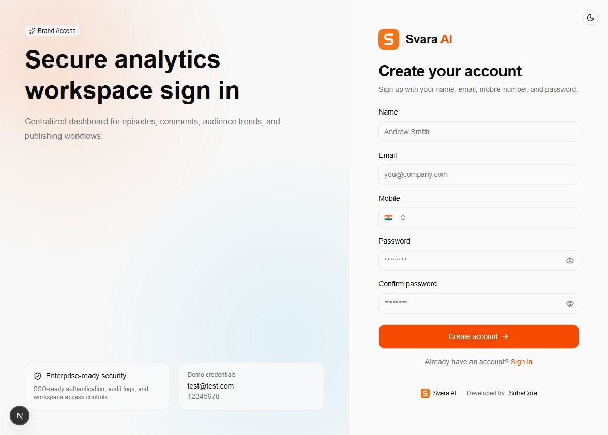
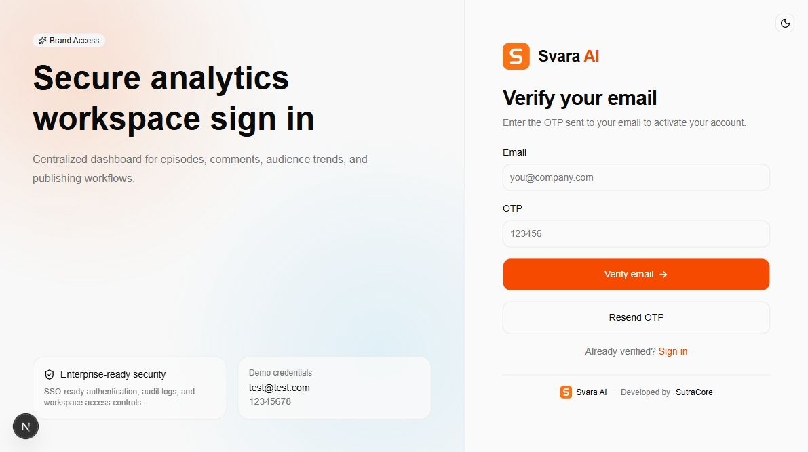
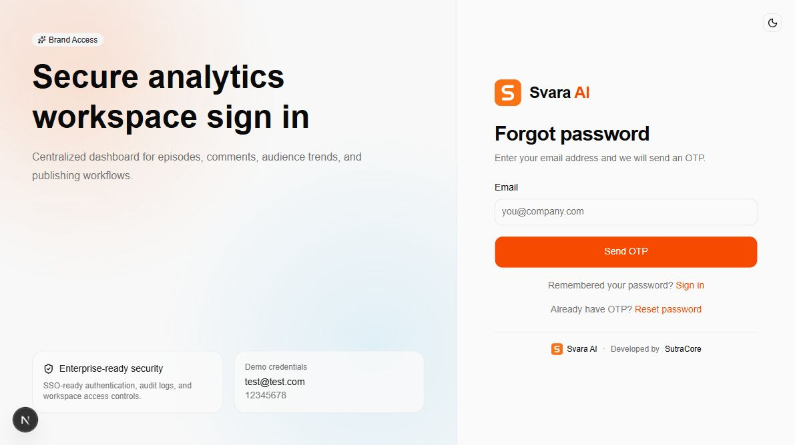
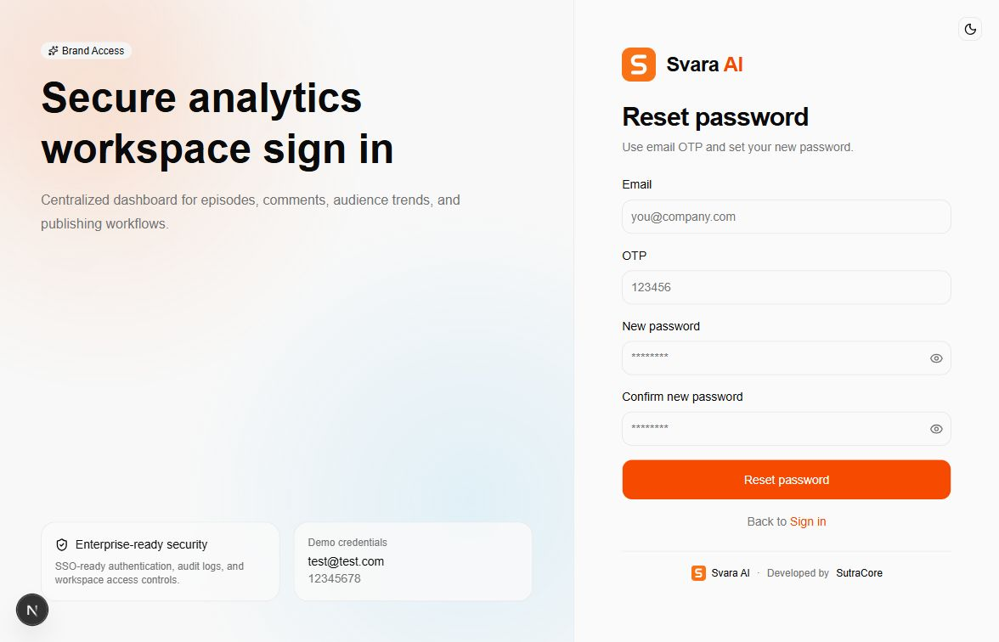
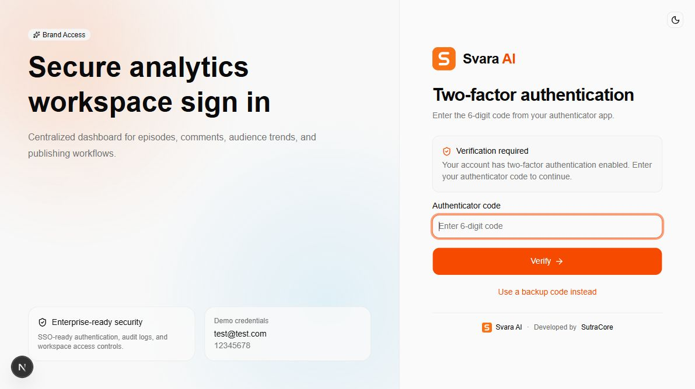
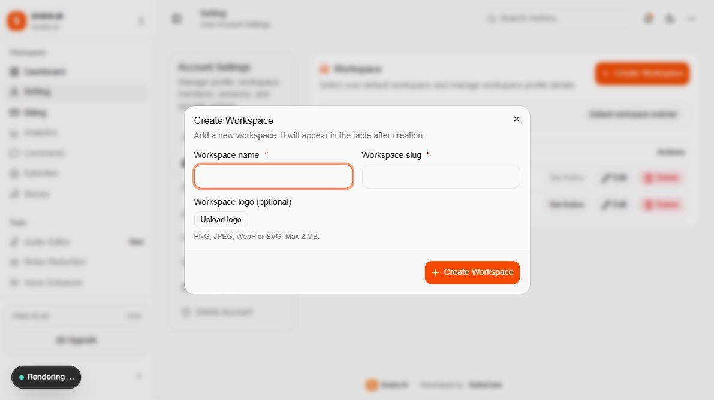

# 01 — Authentication and first access

[Documentation index](INDEX.md) · Next: [Workspaces](02-workspaces.md)

## 1. Sign in

Open `http://localhost:3000/auth/signin`. On a customer deployment, replace `http://localhost:3000` with the deployed HTTPS address.



1. Enter your **Email Address** and **Password**.
2. Select **Keep me signed in** only on a device you trust.
3. Select **Sign in**.
4. An account that has completed onboarding opens `/dashboard`. A new account opens `/auth/onboarding`.

The supplied local demonstration account is `test@test.com` / `12345678`. This is sample access only. A fresh installation requires a newly registered, verified customer account, or a separately restored database.

**Google and GitHub buttons:** the buttons exist, but `lib/auth.ts` does not configure `socialProviders`. These methods need developer configuration and provider credentials before they work. There are no Google/GitHub environment variables currently read by the app. Adding variables alone will not enable social sign-in.

**Passkey sign-in:** select **Sign in with passkey** only if a passkey has already been registered for this application and domain. Follow the browser/device prompt. See document 04 for registration.

## 2. Create an account

Select **Sign up**, or open `/auth/signup`.



1. Enter a name of at least two characters.
2. Enter an email address you can receive mail at.
3. Select the correct country code and enter a valid mobile number. Email addresses and mobile numbers must be unique.
4. Enter and confirm the password. The current form enforces at least eight characters; use a stronger unique password for customer accounts.
5. Select **Create account** and continue to email verification.

Registration does not automatically sign you in. Email verification is required by the server. The mobile field is account information; this implementation does not provide SMS verification.

## 3. Verify email

Open `/auth/verify-email` if you are not already taken there.



1. Confirm the email address.
2. Copy the six-digit OTP from the verification email.
3. Enter the OTP and select **Verify email**.
4. After success, sign in with the verified address and password.

The configured OTP lifetime is **five minutes**. Select **Resend OTP** when a fresh code is needed. Check spam folders and ask the installer to inspect Resend delivery logs if no email arrives. Email credentials are configured on the server, as explained in document 06.

## 4. Recover a forgotten password

From sign-in, select **Forgot password?**.



1. Enter the registered email address and select **Send OTP**.
2. After receiving the email, select the **Reset password** link. The request page does not automatically complete the reset.
3. On `/auth/reset-password`, enter the email, OTP, new password, and matching confirmation.
4. Select **Reset password** and sign in again after the success message.



The **Account** settings panel's password-update button is currently disabled. Use this OTP recovery flow for a password reset. Do not give support personnel your OTP or new password.

## 5. Complete two-factor sign-in

For an account with two-factor authentication enabled, sign-in requires a second verification step at `/auth/two-factor`.



Enter the current six-digit code from your authenticator app and select **Verify**. If the authenticator is unavailable, select **Use a backup code instead** and enter an unused saved backup code. Two-factor setup is described in document 04. This screenshot shows the verification form only; the demonstration account's two-factor setting was not changed.

## 6. First-time onboarding

The implementation contains a three-step onboarding flow:

| Step | What to enter | Result |
| --- | --- | --- |
| Create your workspace | A unique workspace name and optional logo | The app derives a slug from the name |
| Choose your plan | Free, Pro, or Enterprise | Pro attempts a Stripe checkout; a selection alone does not prove payment |
| Almost there | Optional business name and the required discovery-source answer | Submits the workspace and marks onboarding completed |

**Screenshot coverage:** the supplied account was already onboarded, so visiting `/auth/onboarding` redirects to the dashboard. No fresh account or onboarding screenshot was created. The workspace creation screenshot below shows the separately available settings form, which serves the same name/logo purpose; it is not the onboarding screen.



**Current source issue:** onboarding returns `/billing/plan`, including its Pro checkout return URLs. That route does not exist in this source; the plan selection route is `/billing/plans`. If onboarding completes but the next page is missing, open `/dashboard` or `/billing` manually. The developer should correct these URLs before a customer launch. Default plan records must also be seeded before a new workspace is created; see document 07.

## 7. Sign out and protected pages

Select your name/email at the bottom of the sidebar, then **Sign out**. This ends the current session. To review other sessions, use **Setting → Session**. **Delete Account → Sign out all sessions** signs out every device.

The server redirects unauthenticated requests for workspace pages to sign-in. `/` and `/auth` also redirect to sign-in, while `/profile` redirects to `/setting`. Signed-in, onboarded users who visit authentication pages are redirected back to the dashboard.

Implementation references: `lib/auth.ts`, `lib/auth-client.ts`, `lib/validations/auth.ts`, `app/auth/`, `app/actions/onboarding.ts`, and `app/(workspace)/layout.tsx`.

## Code examples and source locations

The following are source excerpts for the developer. Preserve the surrounding validation, loading states, callbacks, and error handling when editing them. Passwords and OTPs come from the form; do not hardcode customer credentials.

### Server authentication policy

In `lib/auth.ts`, `emailAndPassword` controls email verification and automatic sign-in. The `emailOTP` plugin controls OTP length/lifetime. Edit the existing configuration rather than creating a second auth instance.

```ts
// lib/auth.ts — existing options inside betterAuth({...}).
emailAndPassword: {
  enabled: true,
  autoSignIn: false,
  requireEmailVerification: true,
},

// Existing plugin inside plugins: [...]. Keep its sender callback.
emailOTP({
  expiresIn: 60 * 5,
  otpLength: 6,
  sendVerificationOnSignUp: true,
  sendVerificationOTP: async ({ email, otp, type }) => {
    await sendAuthOtpEmail({ email, otp, type });
  },
}),
```

Password/name/mobile validation is defined in `lib/validations/auth.ts`; signup also validates on the server in `app/auth/signup/actions.ts`. Update both layers together when changing registration rules. Keep required verification in place for the customer release.

### Sign-in and registration

```ts
// app/auth/signin/page.tsx — request inside the existing form handler.
authClient.signIn.email(
  {
    email: values.email.toLowerCase(),
    password: values.password,
    rememberMe: values.rememberMe ?? true,
  },
  // Preserve the existing onSuccess/onError callbacks here.
);

// app/auth/signup/page.tsx — invokes server validation and account creation.
const result = await signUpWithValidationAction(values);
```

The sign-in default values read `NEXT_PUBLIC_TEST_EMAIL` and `NEXT_PUBLIC_TEST_PASSWORD`. Blank those public values for customer deployments and remove the separate demo card in `app/auth/layout.tsx`. Brand headings and form text are customized in the relevant `page.tsx` and `app/auth/_components/auth-header.tsx`; see document 09.

### Verification and password recovery

These excerpts use the corresponding form's existing `values` variable. Each belongs in its own page handler.

```ts
// app/auth/verify-email/page.tsx
authClient.emailOtp.verifyEmail({
  email: values.email.toLowerCase(),
  otp: values.otp,
});

// app/auth/forgot-password/page.tsx
authClient.emailOtp.sendVerificationOtp({
  email: values.email.toLowerCase(),
  type: "forget-password",
});

// app/auth/reset-password/page.tsx
authClient.emailOtp.resetPassword({
  email: values.email.toLowerCase(),
  otp: values.otp,
  password: values.password,
});
```

### Two-factor sign-in, passkeys, and route protection

```ts
// app/auth/two-factor/page.tsx — existing verification choices.
await authClient.twoFactor.verifyTotp({ code: code.trim() });
// The backup-code branch uses this alternative, not both calls together:
await authClient.twoFactor.verifyBackupCode({ code: code.trim() });

// app/auth/signin/page.tsx — existing passkey sign-in request.
const result = await authClient.signIn.passkey();
```

The server guard below is in `app/(workspace)/layout.tsx`. Keep page access checks on the server when changing navigation.

```ts
const session = await auth.api.getSession({ headers: requestHeaders });
if (!session) {
  redirect("/auth/signin");
}
```

For the known onboarding URL correction, edit the existing `successUrl`, `cancelUrl`, and final `redirectTo` in `app/actions/onboarding.ts` to use a route that exists, such as `/billing` for the return and `/billing/plans` for plan selection. This is a recommended source change, not one applied by this guide.
