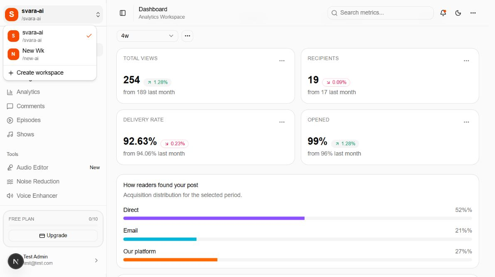
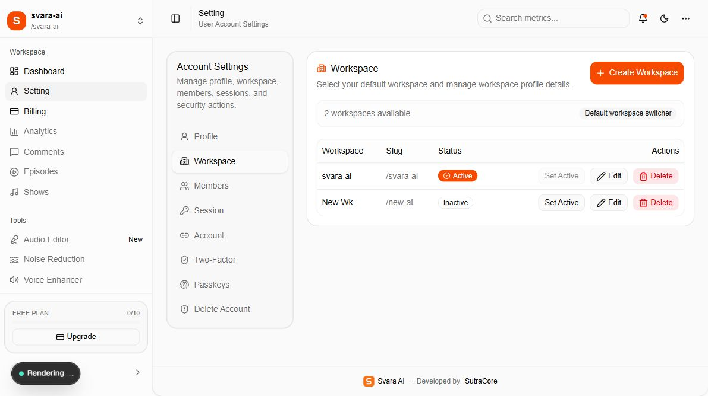
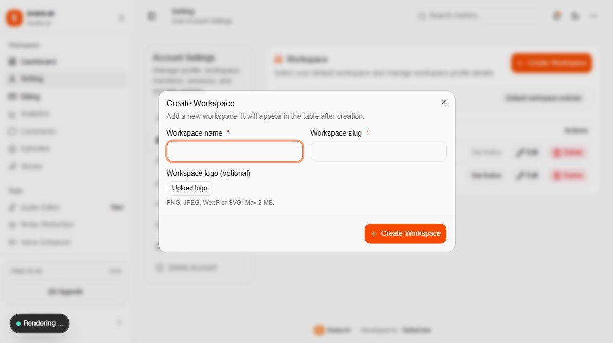
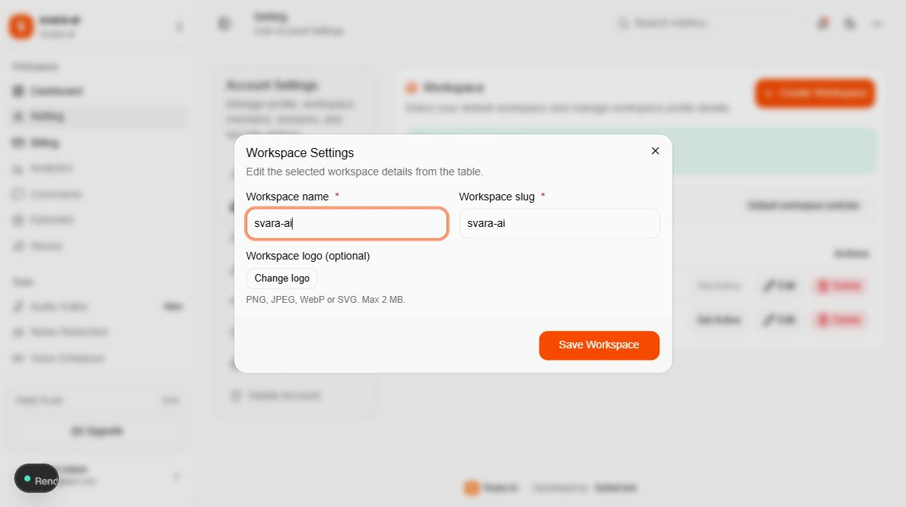
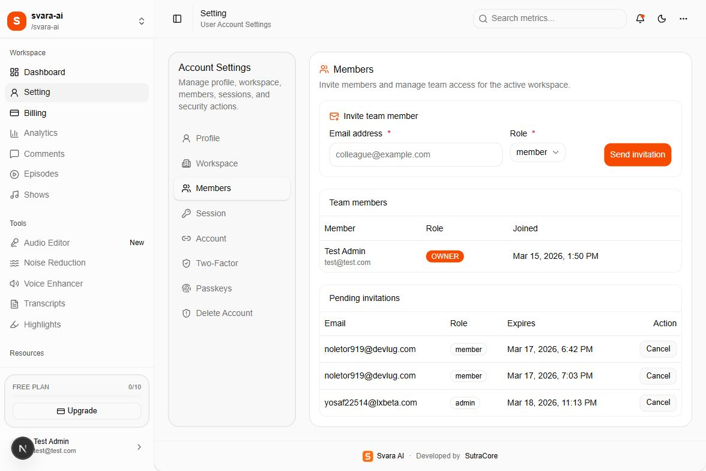

# 02 — Workspaces and team access

[Documentation index](INDEX.md) · Previous: [Authentication](01-authentication.md) · Next: [Dashboard](03-dashboard.md)

A workspace is the organization/team context used for members, subscriptions, and credits. Your personal profile and sign-in methods belong to your account. Always check the active workspace before viewing billing or inviting teammates.

## 1. Switch workspace



Select the workspace name at the top-left of the sidebar, then select an existing workspace. The name and slug at the top-left change to the selected workspace. Alternatively, open **Setting → Workspace** and select **Set Active** in the required row. The active row is labelled **Active** and its Set Active button is disabled.

The **Create workspace** menu item in the top-left dropdown has no action wired in the current source. Use the **Create Workspace** button in settings instead.

## 2. View workspace details

Open **Setting → Workspace**.



| Column | Meaning |
| --- | --- |
| Workspace | Team/organization display name |
| Slug | Unique identifier shown with a leading `/` in the interface |
| Status | Active or inactive for your current session |
| Actions | Set Active, Edit, and Delete |

Two existing demo workspaces appear in the screenshots. Their presence does not mean that a fresh Free account may create two workspaces; new creations are checked against the current limits.

## 3. Create a workspace



1. Select **Create Workspace**.
2. Enter a unique **Workspace name**.
3. Enter a unique **Workspace slug**, such as `customer-studio`. Use a simple lowercase identifier with hyphens.
4. Optionally select **Upload logo**. Accepted files are PNG, JPEG, WebP, or SVG, up to **2 MB**.
5. Select **Create Workspace** and confirm that the new row appears. Use **Set Active** to choose it if needed.

Cloudflare R2 must be configured for image uploads. Creating a workspace initializes its Free allowance; buying Pro on one workspace does not automatically make every new workspace Pro. If you see a limit message, check the account's applicable plan before attempting another creation.

## 4. Edit a workspace



Select **Edit** in the workspace row, change the name, slug, or logo, then select **Save Workspace**. Editing selects that workspace as the active context in the current implementation. Confirm the selected workspace before continuing elsewhere. Names and slugs must not duplicate another workspace.

The backend uses Better Auth organization permissions for updates and deletion. If a member cannot save, ask the workspace owner or administrator to perform the operation. This guide does not promise that every visible button is available to every role.

## 5. Invite teammates



1. Select the correct active workspace.
2. Open **Setting → Members**.
3. Enter the teammate's email and choose **member**, **admin**, or **owner** as appropriate. Grant ownership only to the intended workspace owner.
4. Select **Send invitation**. Resend sends the invitation email.
5. Review **Team members** and **Pending invitations**. Select **Cancel** beside a pending invitation when it should no longer be used.

The email link opens `/auth/signin?invitationId=...`. The recipient must sign in with the exact invited email. A new recipient should register, verify email, and then reopen the original invitation link to sign in. The sign-in flow accepts the invitation and redirects to the dashboard. If the workspace name does not update, select it from the workspace switcher: the custom join endpoint does not explicitly set the active organization.

Current limitations: this panel lists members but does not provide existing-member removal or role-edit controls. The custom join endpoint checks pending status and email match, but does not explicitly compare `expiresAt`; expiry enforcement and repeated-acceptance handling need developer review before launch. The legacy `/auth/join` page requires a real invitation ID and may accept an invitation as a side effect when opened while signed in; it was not opened for documentation capture.

## 6. Understand limits

These are the limits defined in `lib/plans.ts` at release time:

| Plan | Credits per workspace period | Workspace creation limit | Members per workspace |
| --- | --- | --- | --- |
| Free | 10 | 1 | 3 |
| Pro | 100 | 5 | 25 |
| Enterprise | Unlimited in the current allowance model | Unlimited | Unlimited |

Workspace creation is checked across the user's memberships using their best available plan. Member invitations use the selected workspace's plan. Credit usage and period information come from allowance records; confirm billing and allowance synchronization during acceptance testing.

Plan feature names such as `sso`, `advanced_analytics`, and `api_key` are entitlement identifiers. They do not establish that the corresponding customer feature screens have been implemented.

## 7. Delete a workspace

The **Delete** action removes a workspace through Better Auth. Treat it as a destructive operation. Confirm the intended workspace, arrange backups, and have the owner perform it deliberately. The application uses a browser confirmation prompt. Removing a workspace must not be assumed to cancel a Stripe subscription or clean up R2 files automatically; coordinate these separately.

Implementation references: `app/(workspace)/workspace-actions.ts`, `app/(workspace)/workspace-shell.tsx`, `app/(workspace)/setting/workspace.tsx`, `app/(workspace)/setting/members.tsx`, and `app/api/invitation/join/route.ts`.

## Code examples and source locations

### Workspace creation and allowance

`app/(workspace)/workspace-actions.ts` contains server actions for creation, update, deletion, switching, and invitations. This is an excerpt from `createWorkspaceAction`, after its authentication, limit, and uniqueness checks:

```ts
const workspace = await auth.api.createOrganization({
  headers: requestHeaders,
  body: {
    name: normalizedName,
    slug: normalizedSlug,
    logo: input.logo,
  },
});

await initOrganizationAllowance(workspace.id);
```

Keep those checks and allowance initialization if changing workspace creation. UI fields and dialogs are in `app/(workspace)/setting/workspace.tsx`; first-time workspace creation is also handled by `app/actions/onboarding.ts`.

### Switch and invite from the settings handlers

These excerpts use the existing handler variables in `app/(workspace)/setting/settings-client-view.tsx`:

```ts
// Switch: the server action checks the organization through Better Auth.
const result = await setActiveWorkspaceAction(workspaceId);

// Invite: preserve the existing success/error handling and workspace checks.
const inviteResult = await inviteWorkspaceMemberAction({
  workspaceId: selectedWorkspaceId,
  email: inviteEmail.trim().toLowerCase(),
  role: inviteRole,
});
```

Workspace name/logo changes here are database-backed team settings. They do not replace the global Svara AI logo, favicon, brand name, or email branding. Document 09 explains that distinction.

### Plan limits

Edit the matching entries in `lib/plans.ts` when the agreed customer limits change:

```ts
// lib/plans.ts — current Free entry inside PLAN_LIMITS.
free: {
  credits: 10,
  maxWorkspaces: 1,
  maxMembers: 3,
  features: [],
  displayName: "Free",
  sortOrder: 0,
},
```

Update plan marketing text in both `app/auth/onboarding/onboarding-flow.tsx` and `app/(workspace)/billing/plans/page.tsx`. Plan definitions are also stored in `plan_allowance`; arrange a reviewed database update for existing installations. `docs/scripts/initialize-plans.sql` only inserts missing rows and does not overwrite an existing plan.
