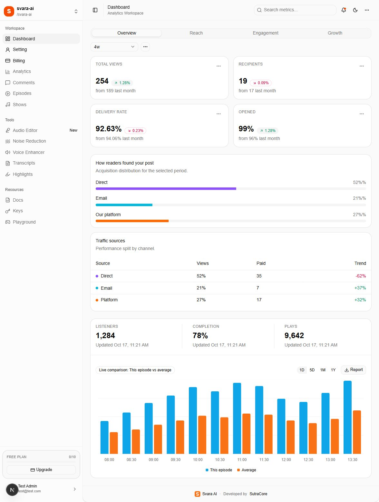
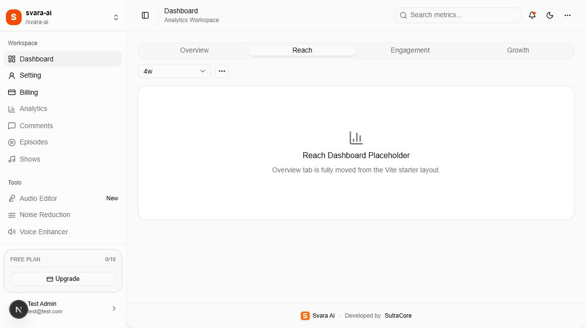

# 03 — Dashboard and navigation

[Documentation index](INDEX.md) · Previous: [Workspaces](02-workspaces.md) · Next: [Settings](04-settings-panel.md)

Open `/dashboard` after signing in and completing onboarding.



## 1. Identify the navigation areas

| Area | How to use it |
| --- | --- |
| Workspace name, top-left | Select an existing team workspace |
| Dashboard | Return to the overview |
| Setting | Open profile, workspace, members, sessions, and account-security panels |
| Billing | View subscription information or the plan selection screen |
| Plan card, bottom-left | Read the active workspace's allowance usage; select Upgrade to open billing |
| Account menu, bottom-left | Open Setting/Billing or sign out |
| Sidebar toggle | Collapse or expand the navigation |
| Sun/moon control | Switch appearance; the choice is stored in the browser |

The **Docs** navigation item inside the app is currently disabled. Open this `docs` folder or the offline HTML guide to read the release documentation.

## 2. Read the Overview

The current screen contains four cards: **Total views**, **Recipients**, **Delivery rate**, and **Opened**. Under them are acquisition distribution, a traffic-source table, and listener/completion/play metrics with a comparison chart.

**These analytics are demonstration data.** Values such as 254 views, 19 recipients, and 1,284 listeners are hardcoded in the source, not read from a live analytics service. The displayed update dates are sample text. Do not use these figures for customer reporting or business decisions.

The sidebar's plan/credit summary is loaded separately from database allowance records. It is not part of the hardcoded analytics. If it disagrees with Billing, use the reconciliation checks in document 08.

## 3. Filters and chart controls

The date-range dropdown offers **Last 7 days**, **Last 4 weeks**, and **Last 3 months**. The chart also has **1D**, **5D**, **1M**, and **1Y** controls. These update UI state, but the current sample dataset is not replaced with period-specific results.

Search, the notification icon, report/download actions, and menu entries such as **Inspect**, **Duplicate view**, and **Save as default** have no implemented analytics workflow in the current source. They should not be described as working exports, saved reports, or searchable live metrics.

## 4. Reach, Engagement, and Growth



**Reach**, **Engagement**, and **Growth** each show a placeholder panel. The screenshot shows Reach; the other two use the same placeholder implementation. These tabs do not yet provide additional analytics.

## 5. Disabled navigation

The following sidebar entries are marked disabled/coming soon in the source: Analytics, Comments, Episodes, Shows, Audio Editor, Noise Reduction, Voice Enhancer, Transcripts, Highlights, Docs, Keys, and Playground. No separate functional pages for these entries are included in this release.

A paid-plan feature list may mention capabilities whose screens are still placeholders or disabled. Confirm the contracted feature scope with the delivery team before presenting those capabilities to an end customer.

Implementation references: `app/(workspace)/dashboard/page.tsx`, `app/(workspace)/dashboard-data.ts`, `app/(workspace)/workspace-shell.tsx`, and `lib/plans.ts`.

## Code examples and source locations

### Navigation labels and page headings

The sidebar entries and header labels live in `app/(workspace)/dashboard-data.ts`. These are existing entries inside their respective arrays/objects:

```ts
// sidebarSections[].items — visible sidebar labels and destinations.
{ label: "Dashboard", icon: LayoutDashboard, href: "/dashboard" },
{ label: "Setting", icon: UserRound, href: "/setting" },
{ label: "Billing", icon: CreditCard, href: "/billing" },

// pageMeta — header label/subtitle for each implemented route.
"/dashboard": { label: "Dashboard", subtitle: "Analytics Workspace" },
"/setting": { label: "Setting", subtitle: "User Account Settings" },
```

Rename the `label` or `subtitle` to change displayed wording. Change `href` only when a corresponding page exists. Removing `disabled: true` from a placeholder item does not implement its feature.

### Demonstration metrics and chart colors

```ts
// app/(workspace)/dashboard-data.ts — current first metricCards entry.
{
  title: "Total views",
  value: "254",
  change: "1.28%",
  trend: "up" as const,
  subtext: "from 189 last month",
},

// Existing listeningChartConfig uses the CSS brand tokens.
episode: { label: "This episode", color: "var(--brand-blue)" },
average: { label: "Average", color: "var(--brand-orange)" },
```

Edit `metricCards`, `readerSources`, `trafficSources`, and `listeningData` for sample content. Connect real server-authorized data before calling these production analytics. Listener/completion/play headings and some numbers are also written directly in `app/(workspace)/dashboard/page.tsx`.

The chart series use CSS tokens, while some source/progress colors use utility classes such as `bg-violet-500` and `text-emerald-600`. Change those explicit classes too if the customer needs a fully consistent palette. See document 09 for the global theme and logo instructions.
