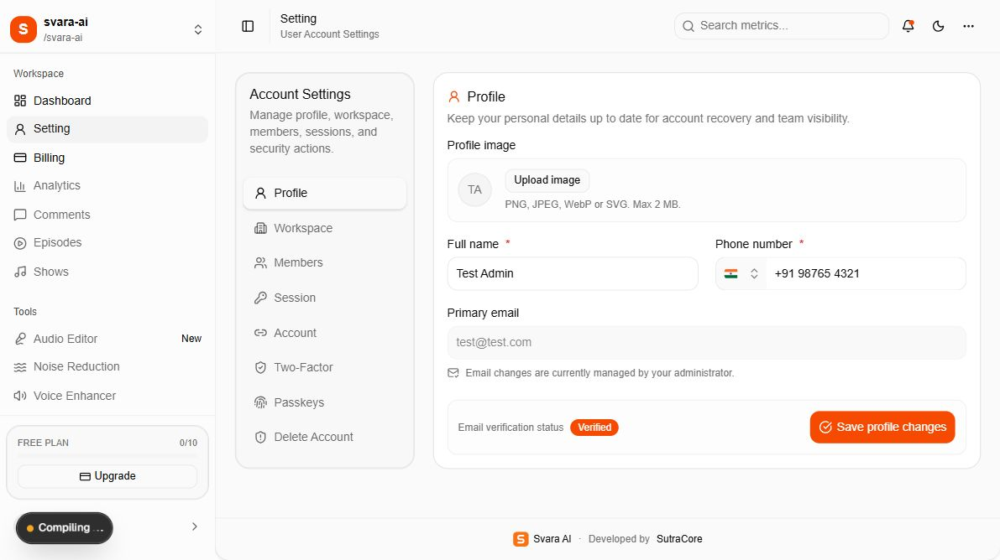
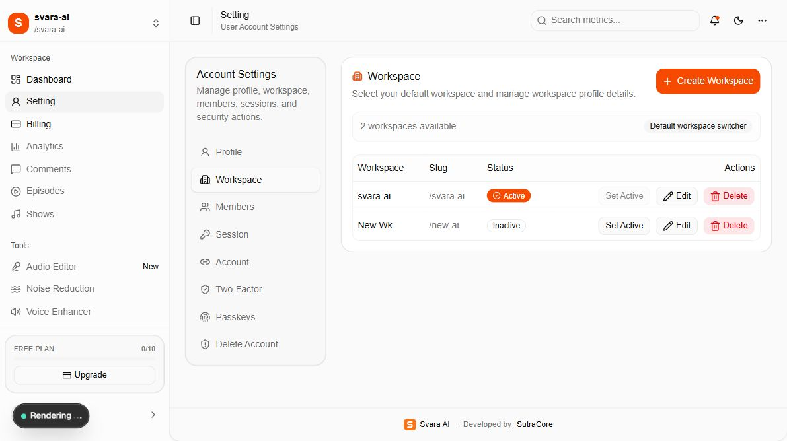
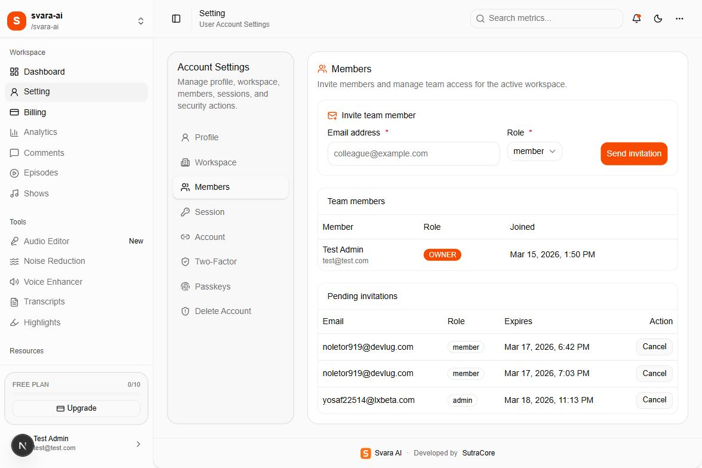
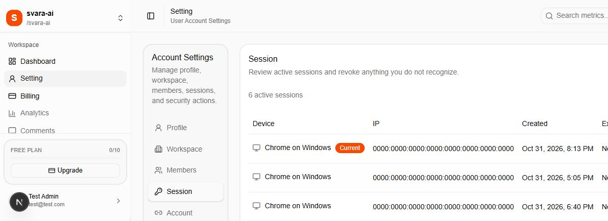
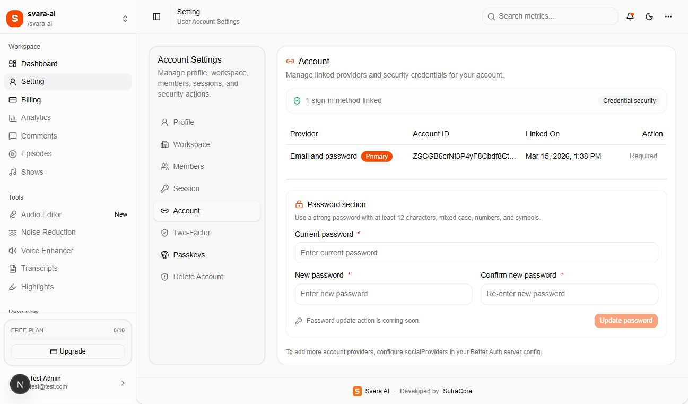
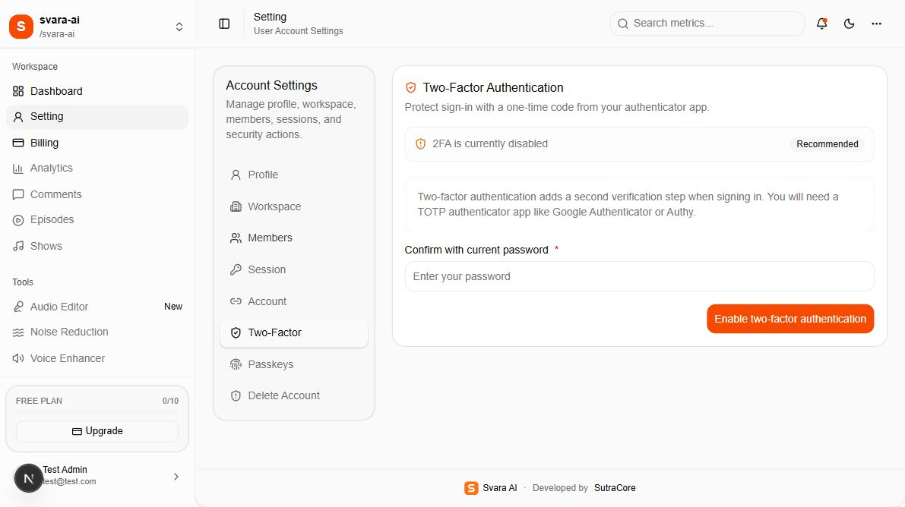
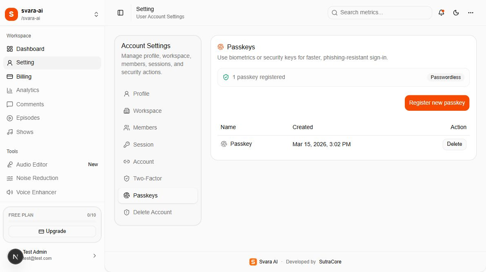
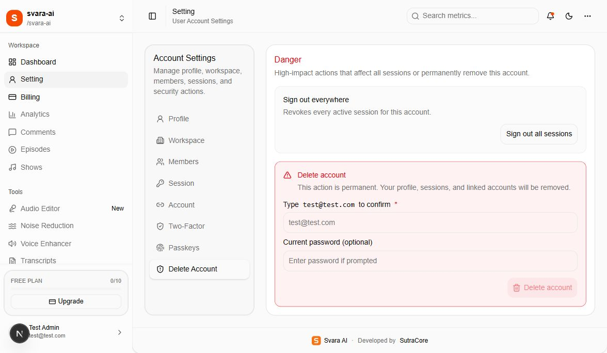

# 04 — Settings panel, one section at a time

[Documentation index](INDEX.md) · Previous: [Dashboard](03-dashboard.md) · Next: [Stripe](05-stripe-configuration.md)

Select **Setting** in the sidebar, or open `/setting`. All eight sections are tabs on this same route. Click the tab label; the current component does not read a `?tab=...` URL parameter.

## 1. Profile



Use this panel to update your display name, mobile number, and profile image.

1. Select **Upload image** to choose a PNG, JPEG, WebP, or SVG up to 2 MB.
2. Edit **Full name** or **Phone number** as required.
3. Select **Save profile changes** and check the success message.

Uploading an image places it in R2 first; saving the profile applies the returned URL to your account. The primary email is read-only and verification status is shown. The interface says email changes are managed by an administrator, but this repository does not supply an administrator email-edit screen. Contact the delivery team for an approved email-change process.

## 2. Workspace



Select **Set Active** to switch context. Use **Create Workspace**, **Edit**, **Save Workspace**, and **Delete** to manage workspace records as permitted by your role. See document 02 for dialog screenshots, field explanations, limits, and destructive-operation guidance.

## 3. Members



The top form sends invitations using an email address and role. **Team members** lists names, emails, roles, and joined dates. **Pending invitations** lists invitation email, role, expiry, and a cancellation control.

Choose the intended workspace first. Sending an invitation requires a configured Resend sender and sufficient workspace allowance. Existing-member role edits/removal are not available from this panel. Invitation acceptance limitations are documented in document 02.

## 4. Session



The table shows device/browser, IP address, creation time, expiry, and **Revoke**. The current session is labelled **Current** and cannot be revoked with its row button.

- **Revoke** ends the selected other session.
- **Revoke other sessions** ends every session except the current one.
- To end your current session, use the account menu's **Sign out**.

Revoking a session can interrupt work on another device. The attached capture is cropped to the upper session rows so that other devices' public IP addresses are not included. Dates are demonstration-session metadata; customer exports should use appropriately redacted captures.

## 5. Account



This panel lists linked sign-in providers, their account identifiers, and when they were linked. The email/password method is **Primary** and marked **Required**. Non-primary providers can be unlinked when another method remains available.

**Update password is disabled and marked coming soon.** Entering values in its fields will not change the password. Use the sign-in page's **Forgot password?** flow instead. Social-provider buttons require additional server setup; they are not enabled by default.

## 6. Two-Factor



The panel shows whether two-factor authentication is enabled. The intended setup sequence is to enter the current password, select **Enable two-factor authentication**, add the displayed secret to an authenticator, save backup codes privately, and enter a six-digit code to verify setup. Subsequent sign-ins use the verification page documented in document 01.

**Developer launch item:** the current QR image URL sends the TOTP secret URI to `api.qrserver.com` for image generation. Replace this with local QR generation before directing production customers to use this setup flow. A TOTP secret and backup codes are credentials and must not appear in release screenshots or shared support messages. Setup was not performed during this documentation review.

If already enabled, disabling two-factor protection requires the current password and the deliberate **Disable** action. Preserve an alternative way to access your account before changing authentication methods.

## 7. Passkeys



Select **Register new passkey**, then follow the browser or device's biometric/security-key prompt. A registered passkey appears with its name and creation date. Use **Sign in with passkey** on the sign-in page afterward.

Passkeys need a compatible browser/device and a secure production origin. Localhost is suitable for development, but a passkey registered for localhost should not be expected to work on the customer domain. A row's **Delete** action removes that passkey; keep another working sign-in method before doing so. No passkey was added or removed for this guide.

## 8. Delete Account



This section contains two separate operations:

| Action | Effect |
| --- | --- |
| Sign out all sessions | Revokes all of this account's sessions and sends the user back to sign-in |
| Delete account | Requests permanent account deletion; the email confirmation must match, and the backend may require a password or recent authentication |

Account deletion removes the account and related authentication records. Do not assume that it cancels subscriptions, deletes public uploads, or transfers workspace ownership. Arrange ownership, billing, data retention, and backups before using it. The deletion action was not executed during documentation capture.

Implementation references: `app/(workspace)/setting/`, especially `settings-client-view.tsx`, and `app/(workspace)/workspace-actions.ts`.

## Code examples and source locations

### Panel labels and the default tab

`app/(workspace)/setting/settings-client-view.tsx` owns the tab list, forms' client state, and action handlers. The page component at `app/(workspace)/setting/page.tsx` supplies authenticated account/workspace data.

```tsx
// Existing container: change defaultValue only to another existing tab value.
<Tabs
  defaultValue="profile"
  orientation="vertical"
  className="w-full flex-col gap-4 lg:flex-row lg:gap-6"
>
  {/* Existing tab list and panel components remain here. */}
</Tabs>

// Existing trigger: the text may be renamed; keep value matched to its panel.
<TabsTrigger value="profile" className="justify-start gap-2 px-3 py-2">
  <UserRound className="size-4" />
  Profile
</TabsTrigger>
```

The snippets below are reference excerpts from the existing handlers, not a sequence to run. Keep the surrounding input validation, authentication checks, confirmations, and result handling.

### 1. Profile code

Edit fields and layout in `app/(workspace)/setting/profile.tsx`; saving calls the server action from the shared client view:

```ts
const result = await updateProfileAction({
  name: profileForm.name.trim(),
  mobile: profileForm.mobile.trim(),
  image: profileForm.image.trim() || undefined,
});
```

### 2. Workspace code

Edit the dialogs in `app/(workspace)/setting/workspace.tsx`. The shared handler submits the current form to `workspace-actions.ts`:

```ts
const result = await updateWorkspaceAction({
  workspaceId: selectedWorkspaceId,
  name: workspaceForm.name.trim(),
  slug: workspaceForm.slug.trim(),
  logo: workspaceForm.logo.trim() || undefined,
});
```

### 3. Members code

Edit the invitation form/table in `app/(workspace)/setting/members.tsx`. The existing invitation request is:

```ts
const result = await inviteWorkspaceMemberAction({
  workspaceId: selectedWorkspaceId,
  email: inviteEmail.trim().toLowerCase(),
  role: inviteRole,
});
```

### 4. Session code

`app/(workspace)/setting/session.tsx` renders the session table. These are the two different existing handler requests; do not execute them together as a diagnostic:

```ts
// One selected other session:
const result = await authClient.revokeSession({ token });

// The separate "Revoke other sessions" handler:
const othersResult = await authClient.revokeOtherSessions();
```

### 5. Account code

`app/(workspace)/setting/account.tsx` contains the linked-provider table and disabled password-update UI. The client view preserves at least one linked method:

```ts
const canUnlinkAccounts = accounts.length > 1;

// Existing unlink handler request, after its guard:
const result = await authClient.unlinkAccount({
  accountId: account.accountId,
  providerId: account.providerId,
});
```

### 6. Two-Factor code

`app/(workspace)/setting/two-factor.tsx` renders setup/status. The shared client view handles setup and verification in separate handlers:

```ts
// Setup handler:
const result = await authClient.twoFactor.enable({
  password: twoFactorPassword,
});

// Separate verification handler:
const verifyResult = await authClient.twoFactor.verifyTotp({
  code: verifyCode,
});
```

Before customer use, replace the external QR image implementation described earlier. Do not log or publish `totpURI` or backup codes while customizing this section.

### 7. Passkeys code

`app/(workspace)/setting/passkey.tsx` renders passkey rows. The separate register and list operations use the configured Better Auth client:

```ts
// Register handler (starts a device/browser prompt):
const result = await authClient.passkey.addPasskey();

// Refresh the displayed list after a successful registration:
const listResult = await authClient.passkey.listUserPasskeys();
```

### 8. Delete Account code

`app/(workspace)/setting/delete-account.tsx` renders the danger panel. Its button enablement comes from the confirmation check below; it is not itself a server authorization check:

```ts
const canDeleteAccount =
  confirmEmail.trim().toLowerCase() === user.email.toLowerCase();
```

The deletion handler and all-session revocation handler are in `settings-client-view.tsx`. Keep both deliberate actions, their error handling, and server-side access controls when changing the panel's wording or appearance.
