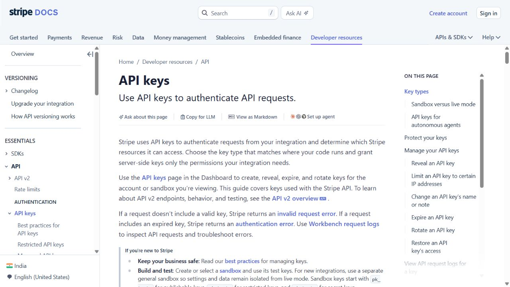
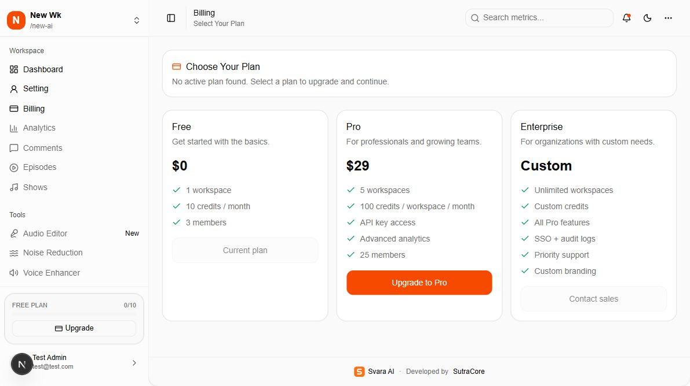
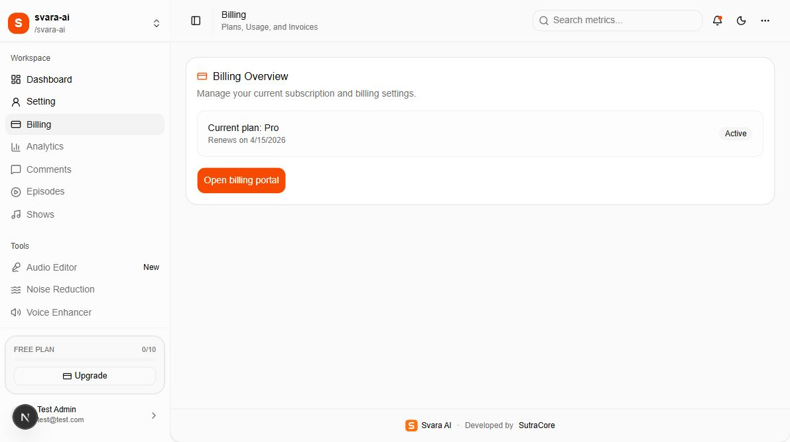

# 05 — Stripe configuration and customer billing

[Documentation index](INDEX.md) · Previous: [Settings](04-settings-panel.md) · Next: [Environment and services](06-environment-and-services.md)

Stripe configuration is an **installer task**. The dashboard's Billing screen does not provide API-key fields. Add the values to the server environment, then restart the application; rebuild when public URL variables change.



This is a reference capture from [Stripe's API-key documentation](https://docs.stripe.com/keys), not a screenshot of the customer's Stripe account. Provider menus can change; use the linked official pages alongside these instructions.

## 1. Obtain the server key

Sign in to the customer's [Stripe Dashboard](https://dashboard.stripe.com/). Select the intended sandbox/test environment first. Open **API keys** and obtain the server key for that environment. Store it as `STRIPE_SECRET_KEY`. A publishable `pk_...` key cannot replace a server key. The app accepts `sk_...` or `rk_...`; a restricted key needs permissions for all subscription, Checkout, customer, and portal operations used by this integration. Keep it on the server. See [Stripe API keys](https://docs.stripe.com/keys).

## 2. Create a monthly Pro price

In **Product catalog**, add a **Pro** product and a recurring monthly price. The current app displays **$29** for Pro, so either create the agreed matching price/currency or have the developer update the UI to match the actual Stripe price. Copy the price's `price_...` identifier into `STRIPE_PRICE_PRO_MONTHLY_ID`; a product's `prod_...` identifier is a different value. See [Manage products and prices](https://docs.stripe.com/products-prices/manage-prices).

`STRIPE_PRICE_ENTERPRISE_MONTHLY_ID` is optional and registers an Enterprise plan in the Better Auth plugin when provided. The current customer plan page has a disabled **Contact sales** button, so it does not offer Enterprise self-service checkout. Free allowances are stored in the app's database and do not require a Stripe Free product or price.

The existing `scripts/setup_stripe_plans.py` can create products, prices, and entitlement features, but it is **not required for manual setup**. It creates new products/prices on each run, and its Enterprise price is $99/month while the UI says Custom. Have the billing owner review it before using it, especially against live credentials.

## 3. Configure the webhook

In Stripe **Workbench → Webhooks**, create an event destination for the deployed endpoint:

```text
https://app.customer.example/api/auth/stripe/webhook
```

Select these events required by the Better Auth integration:

- `checkout.session.completed`
- `customer.subscription.created`
- `customer.subscription.updated`
- `customer.subscription.deleted`

Copy the endpoint's signing secret into `STRIPE_WEBHOOK_SECRET`. It starts with `whsec_` and is separate from the API key. For production, the URL must be reachable over HTTPS. See [Stripe webhooks](https://docs.stripe.com/webhooks) and the [Better Auth Stripe setup](https://better-auth.com/docs/plugins/stripe).

For local testing, install/sign in to the official Stripe CLI and run this in a separate terminal:

```powershell
stripe listen --forward-to localhost:3000/api/auth/stripe/webhook
```

Use the listener's printed signing secret in the local `.env`, then restart the local app. Keep the listener running while testing. The CLI listener secret and deployed endpoint secret are different. The endpoint is provided by `app/api/auth/[...all]/route.ts`; no extra app route needs creating.

## 4. Fill the environment

```dotenv
STRIPE_SECRET_KEY=sk_test_replace_with_customer_test_key
STRIPE_WEBHOOK_SECRET=whsec_replace_with_endpoint_or_cli_secret
STRIPE_PRICE_PRO_MONTHLY_ID=price_replace_with_monthly_pro_price
STRIPE_PRICE_ENTERPRISE_MONTHLY_ID=
NEXT_PUBLIC_APP_URL=http://localhost:3000
```

The first three Stripe variables must all be present for the plugin to register. The billing action additionally checks their prefixes. `NEXT_PUBLIC_APP_URL` determines Checkout/portal return URLs; use the customer's HTTPS origin in production. The active billing flow is the Better Auth integration in `lib/auth.ts` and `app/(workspace)/billing/actions.ts`.

## 5. Configure the customer portal

In [Stripe customer portal settings](https://dashboard.stripe.com/settings/billing/portal), save the intended branding, payment-method, invoice, and subscription/cancellation options. The app creates portal sessions through the API, so no public no-code portal link needs to be pasted into this app. Check which actions the billing owner wants customers to perform. See [Configure the customer portal](https://docs.stripe.com/customer-management/configure-portal).

## 6. What the customer sees



Open **Billing**. A workspace without an active paid subscription is redirected to `/billing/plans`. Free is shown as the current option. **Upgrade to Pro** starts Stripe Checkout for the active workspace. Only proceed with payment during an agreed test or purchase.



A workspace with a recognized subscription sees **Billing Overview**, the plan label, renewal date, and **Open billing portal**. The current code treats `active`, `trialing`, and `past_due` subscriptions as recognized for this page, so its **Active** badge is not proof that all invoices are paid.

The supplied demo workspace shows an old renewal date and a Pro billing record while the allowance sidebar shows Free. These screenshots illustrate existing data; they are not evidence of a current paid invoice or a validated end-to-end billing setup.

## 7. Validate in test mode, then switch to live

Before live release, the billing owner/developer should complete an agreed sandbox checkout and confirm that webhook delivery succeeds, the subscription references the correct workspace, Billing updates, and the allowance becomes Pro with the expected credits. Test renewal and cancellation handling as well. Successful Checkout redirection alone is insufficient because allowance changes are driven by webhook callbacks in `lib/auth.ts`.

For go-live, obtain the live server key, live price IDs, and live endpoint signing secret. Replace all test values together and redeploy. Sandbox objects are separate from live objects, so test price IDs cannot be used with a live key. See [Stripe environments and API keys](https://docs.stripe.com/keys).

No subscription, payment, portal setting, or Stripe resource was created or changed during this documentation task.

## Code examples and source locations

### Server key and plan registration

`lib/auth.ts` reads the server environment and registers Stripe only when its three required values are present:

```ts
const stripeSecretKey = process.env.STRIPE_SECRET_KEY;
const stripeWebhookSecret = process.env.STRIPE_WEBHOOK_SECRET;
const stripeProMonthlyPriceId = process.env.STRIPE_PRICE_PRO_MONTHLY_ID;

// Existing Pro entry inside the Stripe plugin's subscription.plans array:
{
  name: "pro",
  priceId: stripeProMonthlyPriceId,
},
```

The internal plan name `pro` must agree with `lib/plans.ts` and subscription upgrade requests. Changing a customer-facing label does not require renaming that internal identifier. Price amounts/currency live in Stripe; displayed plan cards live separately in `app/(workspace)/billing/plans/page.tsx` and `app/auth/onboarding/onboarding-flow.tsx`.

### Checkout and webhook reference

This source excerpt from `app/(workspace)/billing/actions.ts` attaches Checkout to the authenticated active workspace. `summary`, `requestHeaders`, and `getBaseAppUrl` are defined by the surrounding action:

```ts
const result = await auth.api.upgradeSubscription({
  headers: requestHeaders,
  body: {
    plan: "pro",
    referenceId: summary.activeOrganizationId,
    customerType: "organization",
    successUrl: `${getBaseAppUrl()}/billing`,
    cancelUrl: `${getBaseAppUrl()}/billing/plans`,
    disableRedirect: false,
  },
});
```

Keep the session/workspace checks before this request. The webhook is handled through the existing auth catch-all:

```text
Stripe destination: /api/auth/stripe/webhook
Route entry point:  app/api/auth/[...all]/route.ts
Plugin and hooks:   lib/auth.ts
Allowance changes:  lib/plans.ts
Billing actions:   app/(workspace)/billing/actions.ts
Customer plan UI:  app/(workspace)/billing/plans/page.tsx
```

Edit the existing hooks when adjusting allowance synchronization; adding a second unauthenticated webhook implementation can result in inconsistent records or bypassed signature checks.
