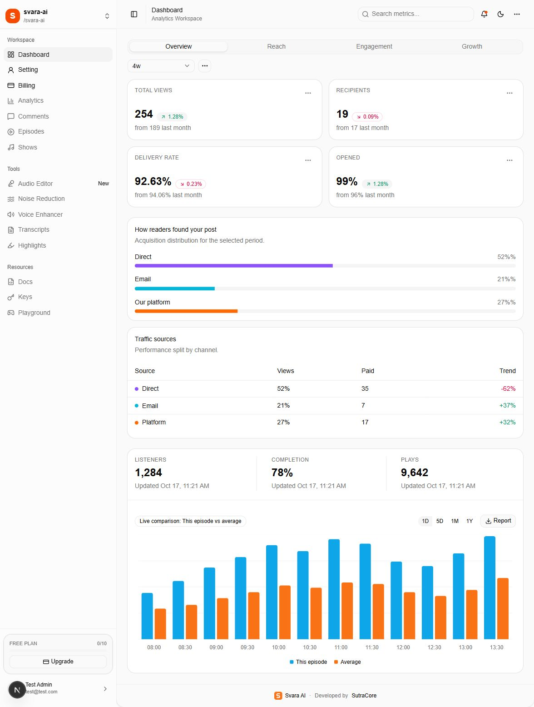

# 07 — Installation, copying the app, and ZIP release

[Documentation index](INDEX.md) · Previous: [Environment and services](06-environment-and-services.md) · Next: [Launch checks](08-launch-checks-and-troubleshooting.md)

## 1. Understand the deliverables

The customer receives source code and this illustrated guide. Existing database records, stored uploads, service credentials, and Stripe account ownership must be handled separately.



After setup, a verified, onboarded customer should reach a dashboard with this structure. The numbers shown are sample data, not a database-restore check.

## 2. Create a source ZIP on the current computer

Open PowerShell in the application folder and run the included packaging helper:

```powershell
Set-Location 'C:\Workspace\JS\svara-app'
.\docs\scripts\create-release.ps1
```

The script prints the ZIP's full path and SHA-256 checksum. Its default output is beside the application folder, with a timestamp in the filename. It packages the **current files**, including current uncommitted source edits. It does not modify Git, the source, or service configuration. Review the source changes you intend to deliver before packaging.

To choose the destination explicitly:

```powershell
.\docs\scripts\create-release.ps1 -OutputPath 'C:\CustomerDelivery\svara-app-final-release.zip'
```

Create the destination folder first. The helper refuses to overwrite an existing archive and verifies the resulting entry names against its exclusion rules. It includes an outer `svara-app` folder for straightforward extraction.

| Include | Exclude |
| --- | --- |
| `app`, `components`, `emails`, `hooks`, `lib`, `public` | `node_modules`, `.next`, build/output/cache folders |
| `scripts`, `drizzle`, `docs`, `package.json`, `bun.lock` | `.git`, editor/local hosting state, unrelated reference folders |
| Root configuration and `.gitignore`; the product README is in `docs/` | Real `.env`/`.env.*` files, keys/certificates, dumps, logs, archives |
| `docs/config/.env.example` with placeholders only | Database volume contents and service-account secrets |

The script uses an explicit list of source folders and root files. If future development adds another required root folder/file, update that list before packaging. It checks filenames, not the meaning of source text; a developer must still ensure no secrets are hardcoded in deliverable source.

If PowerShell blocks local script execution under the customer's policy, follow their administrator-approved script process or use the manual approach below; no permanent policy change is needed by this guide.

## 3. Manual ZIP and folder-copy approach

1. Create a separate staging folder, for example `C:\CustomerDelivery\svara-app`.
2. Copy the **Include** items listed above from the original folder into staging. Do not copy the original `.env`, dependencies, generated builds, dumps, or local caches.
3. Keep `docs/screenshots` beside the Markdown documents; otherwise their images will not open. The HTML reader embeds its own screenshots.
4. Review staging for secrets and confirm `package.json`, `bun.lock`, app source, configuration, and documentation are present.
5. In Explorer, right-click the staging `svara-app` folder and select **Compress to ZIP file** (or the Windows version's **Send to → Compressed (zipped) folder**).
6. Transfer the ZIP and checksum to the intended customer through the agreed delivery channel. Transfer credentials through the customer's secret-management channel separately.

For a direct folder copy instead of ZIP, use the same staging contents. Do not copy a live `node_modules` directory between computers; reinstall from the lockfile on the destination.

## 4. Extract and install prerequisites

The customer needs a Node.js version compatible with Next.js 16 (**20.9 or newer**), Bun for the checked-in lockfile, and access to PostgreSQL. Use the delivery team's tested runtime versions; this repository does not pin them. Docker Desktop/Engine is needed only for the bundled local database approach.

Extract the ZIP, open the extracted `svara-app` folder in a terminal, and check/install dependencies:

```powershell
node --version
bun --version
bun install --frozen-lockfile
```

The repository supplies `bun.lock`, so Bun is the reproducible install path. `npm install` is an alternative, but it resolves without an npm lockfile and creates a new `package-lock.json`; have the developer validate that dependency set before using it for release.

See [Next.js installation requirements](https://nextjs.org/docs/app/getting-started/installation).

## 5. Create configuration

Copy `docs/config/.env.example` to the root `.env` and fill in the values using document 06. Configure Resend before registering a fresh account, because email verification is required. Configure R2 before uploading images. Stripe is optional for initial Free-account access, but needed for paid billing.

For production, choose the final HTTPS origin, set the public URL variables before building, and add the customer image hostname to `next.config.ts` when required.

## 6. Initialize a NEW local database

These steps apply to a **new empty development/customer database**, not an existing production database.

```powershell
docker compose up -d postgres
docker compose ps
bun run db:push
```

Wait until PostgreSQL is healthy before running `db:push`. Review the proposed schema operations. The source of truth is `lib/db/schema.ts`, as selected by `drizzle.config.ts`; `auth-schema.ts` is not the configured Drizzle schema.

`db:push` creates the schema but does **not** insert the default plan rows. Seed them before the first onboarding/workspace creation:

```powershell
Get-Content -Raw '.\docs\scripts\initialize-plans.sql' | docker compose exec -T postgres sh -c 'psql -U "$POSTGRES_USER" -d "$POSTGRES_DB" -v ON_ERROR_STOP=1'
```

For a new managed PostgreSQL database, use the same `DATABASE_URL` for `db:push` and run `initialize-plans.sql` through the provider's SQL console or a trusted PostgreSQL client. The supplied SQL inserts missing default plan definitions only; it does not replace existing custom limits.

Do not blindly execute every historical SQL migration in filename order: this repository contains both `0004_plan_allowance.sql` and `0005_cuddly_jasper_sitwell.sql` with overlapping table creation. For upgrades to an existing database, take a backup and have the developer prepare a reviewed migration path. This release does not execute schema changes on the current database.

## 7. Start and confirm access

For development:

```powershell
bun run dev
```

Open `http://localhost:3000/auth/signin`. On a fresh database, use **Sign up**, verify the email, sign in, and complete onboarding. There is no automatic seed for the demo account. If onboarding reaches the known missing `/billing/plan` route, open `/dashboard` and have the developer correct the redirect.

For a production Node.js deployment:

```powershell
bun run build
bun run start
```

Run the production process under the hosting provider's service/process management with HTTPS, persistent database access, configured environment variables, and the public Stripe webhook. The Compose file does not deploy Next.js, configure a reverse proxy, provide certificates, or configure backups. Hosting the app on Cloudflare itself needs a deployment adapter/platform decision; the current Cloudflare integration is R2 storage only.

## 8. Move existing data and files separately

If transferring existing customer data, arrange a PostgreSQL backup/restore and R2 object migration in addition to the source ZIP. Preserve object paths or update stored image URLs when the bucket/domain/prefix changes. Stripe customers/subscriptions stay in their Stripe account and require a separate continuity plan if that account changes.

The existing `scripts/migrate_to_new_instance.py` supports R2 copy, database transfer, and URL rewriting. It requires `boto3`, `python-dotenv`, source Docker PostgreSQL, old R2 values, target R2 values, and `NEW_DATABASE_URL`. Review its source and begin with its documented dry run:

```powershell
python scripts/migrate_to_new_instance.py all --dry-run
```

Do not use its `--force` option as routine setup; it can drop target database tables. A source ZIP is not a database backup. Keep encrypted backups and test restoration independently.

## 9. Complete delivery

Record the ZIP checksum, deployed URL, runtime versions, service-account owners, database backup location, R2 bucket/domain, Stripe mode/webhook URL, support contact, and unresolved issues. Record secret-store references rather than secret values. Complete the checklist in document 08 with the customer.

## Code examples and source locations

### Application commands

These selected commands already exist under `scripts` in `package.json`. This is a reference excerpt, not a replacement for the whole scripts object:

```json
{
  "dev": "next dev",
  "build": "next build",
  "start": "next start",
  "brand:generate": "node scripts/generate-brand-assets.mjs",
  "db:push": "drizzle-kit push"
}
```

Run `bun run brand:generate` only after editing the brand mark or generator colors as described in document 09. Schema push is for the reviewed new-database setup above; it is not a backup/restore operation.

### Packaging scope

If a later feature adds a required source folder, update the explicit include list in `docs/scripts/create-release.ps1`:

```powershell
# Existing list in create-release.ps1:
$folders = @('app', 'components', 'emails', 'hooks', 'lib', 'public', 'scripts', 'drizzle', 'docs')
```

Keep the credential/build-output exclusion rules in that script. Add required root files to `$rootFiles` separately. Before delivery, rebuild the reader and package the resulting docs alongside the source:

```powershell
node .\docs\scripts\build-guide.cjs
node .\docs\scripts\verify-docs.cjs
.\docs\scripts\create-release.ps1
```

The helper prints an archive path and SHA-256. Verify an archive's checksum with:

```powershell
# Replace this example path with the path printed by the helper.
Get-FileHash -LiteralPath 'C:\CustomerDelivery\svara-app-final-release.zip' -Algorithm SHA256
```
