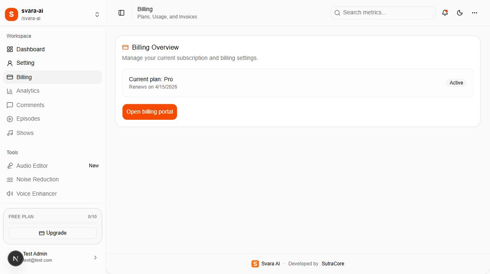

# 08 — Launch checks, current limitations, and support

[Documentation index](INDEX.md) · Previous: [Installation and ZIP](07-installation-and-zip-release.md) · Next: [Branding and configuration](09-branding-and-app-configuration.md)

## 1. What was reviewed

The documentation review used the supplied local test login on **31 October 2026**. It confirmed sign-in, dashboard navigation, all eight settings panels, workspace forms, the existing workspace selector, a subscribed workspace's Billing Overview, and an alternate workspace's plan selection page. Authentication forms were captured while signed out. The original workspace was restored before signing out.



No OTP or invitation email was sent. No account was created or deleted, no password/2FA/passkey was changed, no workspace content was saved, and no payment, subscription, deployment, or database migration was performed. First-time onboarding was inspected in source because the supplied account is already onboarded. Provider screenshots show public help pages only. This is a documentation release, not a production-readiness certification.

## 2. Acceptance checklist

The delivery team and customer should record a result for each applicable check:

- [ ] Extract the source ZIP on the customer's machine and verify its checksum.
- [ ] Confirm real `.env` values and private keys are absent from the source archive.
- [ ] Confirm customer ownership/access for hosting, DNS, database, R2, Resend, and Stripe.
- [ ] Install dependencies from `bun.lock`; record Node.js/Bun versions.
- [ ] Configure database access and seed default plan definitions on a new database.
- [ ] Complete a production build and start the intended hosting process.
- [ ] Register a controlled customer test user, receive OTP, verify, sign in, and complete onboarding.
- [ ] Correct onboarding return URLs and test the full Pro onboarding path.
- [ ] Confirm all production links, canonical URLs, email links, and checkout returns use the customer domain.
- [ ] Upload/save a small profile image and workspace logo, then load their public URLs.
- [ ] Create/switch/edit a workspace with the intended owner role; verify permissions with a member account.
- [ ] Send/accept an invitation with a controlled recipient and verify the correct active workspace.
- [ ] Correct invitation expiry and duplicate-acceptance handling in the custom join endpoint.
- [ ] Test OTP password recovery with a controlled account.
- [ ] Replace external TOTP QR generation; then test 2FA setup, sign-in, and backup codes.
- [ ] Register/test a passkey on the final production domain with a controlled account.
- [ ] Complete sandbox billing tests, verify webhook delivery, reconcile subscription and allowance records, and test portal access.
- [ ] Confirm agreed live Stripe prices/currency match the app's displayed prices before accepting payments.
- [ ] Remove demo credentials/prefills and arrange the test-account retirement process.
- [ ] Agree which placeholder/disabled features are outside the delivered customer scope.
- [ ] Test database/R2 restoration and record support and renewal responsibilities.

## 3. Current source and data limitations

| Finding | Customer impact / required follow-up |
| --- | --- |
| Onboarding uses `/billing/plan`, but the implemented route is `/billing/plans` | New-user and Pro-checkout return paths can end on a missing page; correct the source URLs |
| Demo credentials are displayed on public auth pages and prefilled in sign-in | Remove the demo card and blank the public prefill variables before launch; handle the test account separately |
| Google/GitHub UI exists without server `socialProviders` | Configure and test OAuth in code, or remove/disable those entry points |
| Dashboard metrics are hardcoded; three analytics tabs are placeholders | They do not represent live customer analytics |
| Several sidebar items, report/search actions, and top-left Create workspace are unwired | Use Setting → Workspace for creation; agree feature scope before release |
| Account password-update button is disabled | Use the OTP password-reset flow |
| Two-factor setup sends a secret URI to an external QR service | Generate QR codes locally before production use |
| Custom invitation acceptance lacks an explicit expiry comparison and does not explicitly switch the active organization | Review expiry, repeat acceptance, and workspace-selection behavior |
| Billing authorization in `lib/auth.ts` accepts any workspace membership | Do not promise owner-only billing controls; tighten role checks if that is the customer requirement |
| Existing demo Billing says Pro while allowance/sidebar says Free | Reconcile records and webhook processing; legacy screenshot state is not proof of correct billing |
| Billing's Active badge also covers `past_due` records | Check actual Stripe status/invoices rather than relying on this badge |
| Plan features advertise API keys, SSO, and advanced analytics | Entitlement labels are not proof those customer-facing features exist |
| Historical SQL includes overlapping allowance-table creation | Use a reviewed upgrade path; new setup uses schema push plus missing-plan seeding |
| Account/workspace deletion is separate from provider billing/storage | Review ownership, cancel/manage subscriptions, and handle stored files explicitly |

These findings were documented, not changed as part of this task.

## 4. Troubleshooting

| Symptom | Checks and recovery |
| --- | --- |
| `DATABASE_URL is not configured` | Place `.env` beside `package.json`, check the variable spelling, then restart the app |
| Database connection refused | Start PostgreSQL, wait for health, check host/port, database credentials, firewall, and required TLS settings |
| Missing table on a new installation | Confirm `DATABASE_URL` points to the new database, then initialize the schema with the reviewed `db:push` step |
| `Free plan_allowance row missing` | Run `docs/scripts/initialize-plans.sql` against the initialized new database before onboarding |
| Email not verified / no OTP | Use Verify email → Resend OTP; inspect Resend domain, sender, key, logs, and spam folder |
| Password reset appears to do nothing | Request OTP first, then follow Reset password and complete that form; the settings password button is disabled |
| Google/GitHub sign-in fails | Server OAuth providers are not configured in this version |
| Redirects go to localhost after deployment | Align app/auth/public URL variables, rebuild the client bundle, and restart/redeploy |
| Onboarding ends on a 404 | Open `/dashboard` or `/billing`; correct the source's singular `/billing/plan` URLs |
| Image upload returns 401 | Sign in again; uploads require a valid session |
| R2 upload fails | Check account ID, bucket, S3 key pair, bucket-scoped write permission, and endpoint jurisdiction |
| Uploaded image does not display | Check `R2_PUBLIC_URL`, object key/prefix, public access, and the Next.js image-host allowlist |
| Workspace name/slug/mobile/email already exists | Use a unique value; the app enforces uniqueness |
| Invite does not join the workspace | Use the invited email, reopen the original link after registration, inspect pending state, and select the workspace explicitly |
| Workspace/member limit reached | Confirm the applicable plan and allowance; review limits in document 02 |
| Invalid Stripe configuration | Use a server `sk_`/`rk_` key, `whsec_` signing secret, and `price_` Pro ID from the same account/environment |
| Paid checkout completes but sidebar remains Free | Inspect webhook delivery/signature, workspace reference, subscription row, and organization allowance; do not solve by manually editing only a UI label |
| Billing portal unavailable | Confirm the workspace has the expected Stripe customer/subscription and that portal configuration is saved in the matching environment |
| Passkey works locally but not on the customer domain | Register it again on the final domain; verify HTTPS and device/browser support |
| Changes to `.env` are ignored | Restart the server; rebuild/redeploy for `NEXT_PUBLIC_*` changes; check duplicate variable definitions |
| A `?tab=workspace` link still shows Profile | Click Workspace explicitly; the current settings component does not parse the tab query parameter |

## 5. Information to collect for support

Give support the page URL/path, action taken, exact error text, timestamp with timezone, browser version, deployment/version identifier, and a redacted screenshot. For provider issues, include a non-secret event/request ID when available. Do not include passwords, OTPs, secret keys, session tokens, TOTP URIs, backup codes, a raw `.env`, or an unredacted database dump.

## 6. Delivery record template

| Item | Customer/delivery team to complete |
| --- | --- |
| Customer and workspace owner | ____________________ |
| Deployed HTTPS address | ____________________ |
| Source archive and SHA-256 | ____________________ |
| Hosting / DNS owner | ____________________ |
| Database owner and backup location | ____________________ |
| Cloudflare account / R2 bucket / public domain | ____________________ |
| Resend owner / verified sender | ____________________ |
| Stripe owner / mode / webhook URL | ____________________ |
| Secret-store references (no secret values) | ____________________ |
| Node.js / Bun versions | ____________________ |
| Agreed feature scope and open issues | ____________________ |
| Support contact and renewal responsibility | ____________________ |
| Customer acceptance date | ____________________ |

## Code examples and source locations

### Read-only setup checks

Run these from the application root when collecting installation information. They show versions/status and whether configuration files exist; they do not print `.env` contents or revoke sessions:

```powershell
node --version
bun --version
docker compose ps
Test-Path -LiteralPath '.\.env'
Test-Path -LiteralPath '.\docs\config\.env.example'
node .\docs\scripts\verify-docs.cjs
```

If using managed PostgreSQL without local Docker, skip `docker compose ps`. A `True` result for `.env` only proves that the file exists; it does not prove the credentials work.

### Find the implementation to investigate

```text
Login / OTP / auth plugins       lib/auth.ts; app/auth/; lib/validations/auth.ts
Database schema and connection  lib/db/schema.ts; lib/db.ts; drizzle.config.ts
Workspace operations            app/(workspace)/workspace-actions.ts
Invitation acceptance           app/api/invitation/join/route.ts
Image uploads                   app/api/upload/route.ts; lib/s3.ts; next.config.ts
Email sending                   lib/resend.ts; emails/
Checkout / portal               app/(workspace)/billing/actions.ts
Webhook / allowance callbacks  lib/auth.ts; lib/plans.ts
Logo / color / naming           See document 09 before making a rebrand
```

When sharing source excerpts or console errors with support, replace secret values with placeholders. Do not use `Get-Content .env` or print full process environment variables in a support transcript.
