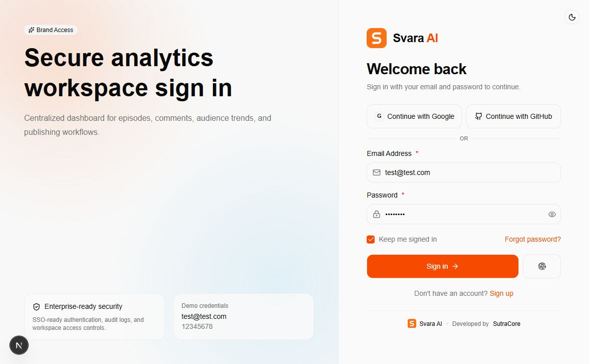
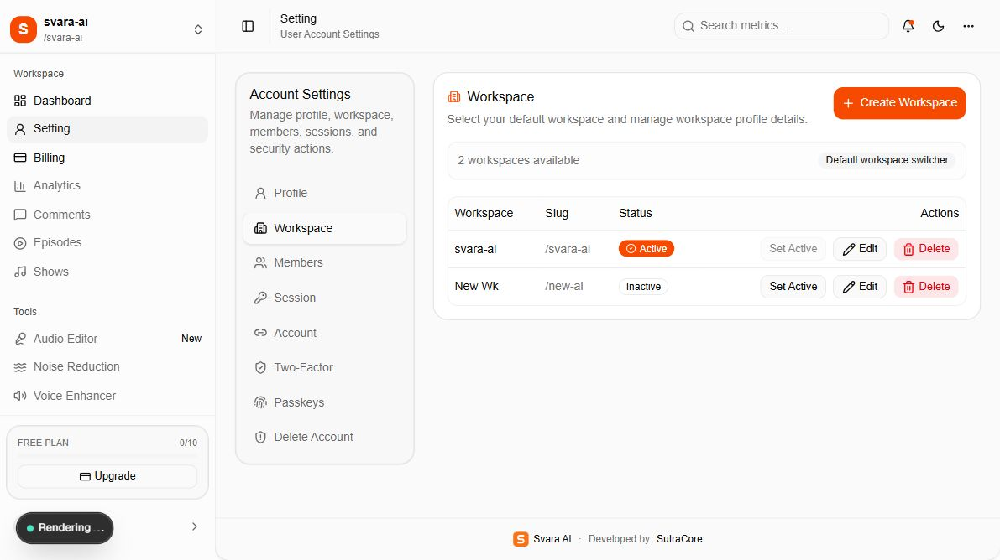

# 09 — Branding, logo, colors, and app configuration

[Documentation index](INDEX.md) · Previous: [Launch checks](08-launch-checks-and-troubleshooting.md)

This chapter explains **where to edit the source** for a customer rebrand. The snippets are customization examples; the documentation update does not change the running application's branding or service settings. Work from an agreed customer name, logo, color palette, and domain, then rebuild and verify the affected surfaces.



The screenshot shows the current Svara AI baseline. The square mark, visible wordmark, footer, button colors, and left-side marketing copy are separate customization points.

## 1. Quick source map

| Change required | File / location | What to change |
| --- | --- | --- |
| Main square logo | `public/assets/logo.svg` | Replace the SVG artwork; retain a square `64 × 64` viewBox for the existing generator |
| Visible sign-in/signup wordmark | `components/common/brand-logo.tsx` | Hardcoded `Svara` / `AI` text and icon-only alt text; logo dimensions/spacing if necessary |
| Shared name and description | `lib/seo.ts` → `siteConfig` | `name`, `title`, `description`, `socialImageAlt`, and agreed `developer` credit |
| Footer branding | `components/common/site-footer.tsx` | Uses `siteConfig.name`, `siteConfig.developer`, and `/assets/logo.svg`; edit layout/credit wording here |
| Canonical public domain | Root environment → `NEXT_PUBLIC_SITE_URL` | Site metadata, email logo base URL, sitemap, robots host, and social-image domain |
| Browser/install theme color | `lib/seo.ts` → `siteConfig.themeColor` | Hex color used by metadata, manifest, and social preview accents |
| Light/dark UI colors | `app/globals.css` → `:root` and `.dark` | Primary, foreground, sidebar, focus ring, chart, and brand tokens |
| Fonts and corner radius | `app/globals.css` | `--font-sans`, `--font-mono`, `--radius`; provide/load any custom font separately |
| Auth marketing copy/gradients | `app/auth/layout.tsx` | Shared left-hand headings, supporting text, demo card, and explicit gradient colors |
| Individual form headings | `app/auth/*/page.tsx` and `app/auth/_components/auth-header.tsx` | Each page's title/subtitle and the shared heading layout |
| Browser favicon and app icons | `scripts/generate-brand-assets.mjs` | Generate icons from the main SVG; adjust its explicit background colors for the new brand |
| Installed app short name/background | `app/manifest.ts` | `short_name`, `background_color`, categories, and other manifest options |
| Social-share preview | `app/opengraph-image.tsx` | Hardcoded wordmark/headline/tagline, background, decorative colors, and layout |
| Additional SEO keywords/copy | `app/layout.tsx`, `app/auth/signin/layout.tsx`, `app/auth/signup/layout.tsx` | Hardcoded keyword and page-description text |
| Email logo, name, and footer | `emails/email-layout.tsx` | Logo alt text, tagline, copyright text, inline style constants; visible header name already uses `siteConfig.name` |
| Email buttons and message copy | Individual `emails/*.tsx` files | Their text, links, and inline accent colors |
| Email From display name/address | Root environment → `RESEND_FROM_EMAIL` | Agreed display name and verified-domain sender address |
| Team workspace name/logo | **Setting → Workspace**, or workspace source files | Database-backed team identity, distinct from the application's global brand |
| Dashboard menu/header labels | `app/(workspace)/dashboard-data.ts` | `sidebarSections`, `pageMeta` |
| Settings labels/default panel | `app/(workspace)/setting/settings-client-view.tsx` | Tab text and `defaultValue`; individual panels contain their own labels |
| App plan limits/prices | `lib/plans.ts`, both plan-card UIs, Stripe, and allowance records | Keep configured entitlements, stored rows, marketing text, and actual Stripe pricing aligned |

There is no runtime “global brand settings” panel and no existing `NEXT_PUBLIC_BRAND_NAME` or `NEXT_PUBLIC_PRIMARY_COLOR` variable. Adding those names to `.env` alone will not change the UI. Use the source locations above, or have the developer deliberately implement a centralized runtime branding feature.

## 2. Replace the main logo and regenerate icons

The shared square logo is `public/assets/logo.svg`. A safe approach with the current generator is to replace its artwork while retaining this SVG envelope:

```svg
<!-- public/assets/logo.svg — structural example, not finished customer artwork. -->
<svg width="64" height="64" viewBox="0 0 64 64"
     fill="none" xmlns="http://www.w3.org/2000/svg">
  <!-- Insert the approved square customer logo artwork here. -->
</svg>
```

Keep artwork self-contained so rasterization does not depend on external images or fonts. The existing maskable-icon generator assumes a `0 0 64 64` source coordinate space. If the customer's source has a different viewBox or needs a wide wordmark, update the generator's embedded viewBox/scaling and the relevant display dimensions, or provide separate square icon and wordmark assets.

Before regenerating, change the explicit `#F97316` background values in `scripts/generate-brand-assets.mjs` to the approved icon background. Those values are not read from `app/globals.css` or `siteConfig.themeColor`.

From the application root, run:

```powershell
bun run brand:generate
```

The generator writes these files. Edit the SVG source and regenerate them together rather than manually replacing only one output:

```text
app/icon.svg                         SVG browser icon copied from the source
app/favicon.ico                      Browser/favicon sizes 16, 32, and 48
app/apple-icon.png                   Apple touch icon, 180 × 180
public/assets/icon-192.png           App/email icon, 192 × 192
public/assets/icon-512.png           App icon, 512 × 512
public/assets/icon-maskable-512.png  Installed-app maskable icon, 512 × 512
```

The auth logo component, site footer, and social-image renderer read the main logo file. Email headers read the generated `icon-192.png` using an absolute site URL. Verify all of these after rebuilding; an email logo must be reachable from the recipient's device, so a localhost URL is unsuitable for customer delivery.

## 3. Change the global brand name and attribution

### Code examples and source locations

Edit the matching fields in the existing `siteConfig` object in `lib/seo.ts`. This complete object example uses a fictional customer name; retain the metadata helpers and exports below it:

```ts
export const siteConfig = {
  name: "Customer Studio",
  title: "Customer Studio | Podcast Analytics",
  description: "Podcast analytics and a shared publishing workspace for your team.",
  url: new URL(
    process.env.NEXT_PUBLIC_SITE_URL || "https://app.customer.example",
  ).origin,
  developer: "SutraCore", // Set the developer attribution agreed for delivery.
  themeColor: "#2563eb",
  socialImageAlt: "Customer Studio — podcast analytics and publishing workspace.",
};
```

`siteConfig.name` already feeds the page title template, application metadata, structured-data application name, footer, email header name, and manifest full name. It does **not** currently replace these hardcoded values:

- `Svara` / `AI` and icon alt text in `components/common/brand-logo.tsx`.
- The wordmark and marketing headline in `app/opengraph-image.tsx`.
- `short_name: "Svara"` in `app/manifest.ts`.
- Auth-page metadata descriptions and `app/layout.tsx` keywords.
- Email logo alt text, copyright name, and message-specific wording.
- The offline guide's own branding in `docs/scripts/build-guide.cjs` and these Markdown documents.

To make the visible auth wordmark follow the shared name, one possible developer change is the component below. It replaces the existing component body, adds the `siteConfig` import, and retains the existing `Image`, `cn`, and `BrandLogoProps` definitions:

```tsx
// components/common/brand-logo.tsx — optional customization example.
import { siteConfig } from "@/lib/seo";

export function BrandLogo({ className, iconOnly = false }: BrandLogoProps) {
  return (
    <span className={cn("inline-flex shrink-0 items-center gap-3", className)}>
      <Image
        src="/assets/logo.svg"
        alt={iconOnly ? siteConfig.name : ""}
        width={40}
        height={40}
        className="size-10 shrink-0"
      />
      {!iconOnly && (
        <span className="whitespace-nowrap text-2xl font-semibold tracking-tight text-foreground">
          {siteConfig.name}
        </span>
      )}
    </span>
  );
}
```

This example uses a single-color wordmark. For a two-color customer wordmark, edit the text spans deliberately rather than retaining the old hardcoded `AI` suffix.

`package.json` → `name` is a technical package identifier (`svara-app`), not the visible app brand. Changing it does not change the UI. If renaming the project/folder as well, review the ZIP helper's fixed `svara-app` archive root and the local Compose container/database names separately.

## 4. Change the color palette, typography, and spacing

In `app/globals.css`, `@theme inline` maps Tailwind tokens to CSS variables. Edit values in the existing `:root` and `.dark` blocks while preserving the other tokens. This example shows a blue customer primary palette:

```css
/* Merge these values into the existing blocks; do not remove other tokens. */
:root {
  --primary: #2563eb;
  --primary-foreground: #ffffff;
  --ring: #2563eb;
  --sidebar-primary: #2563eb;
  --sidebar-primary-foreground: #ffffff;
  --sidebar-ring: #2563eb;
  --brand-orange: #2563eb; /* Legacy token name used for one chart series. */
  --brand-blue: #0ea5e9;
  --radius: 0.75rem;
}

.dark {
  --primary: #60a5fa;
  --primary-foreground: #111827;
  --ring: #60a5fa;
  --sidebar-primary: #60a5fa;
  --sidebar-primary-foreground: #111827;
  --sidebar-ring: #60a5fa;
}
```

`bg-primary`, `text-primary`, buttons, and several selected/focus states use these tokens. The chart comparison uses `--brand-blue` and `--brand-orange`. Also review `--brand-cyan`, `--brand-purple`, `--chart-1` through `--chart-5`, and explicit color utilities in `dashboard-data.ts` and the dashboard component. Keep success/error indicators distinguishable from the brand accent.

There are additional colors outside the global tokens:

| Surface | Additional values to review |
| --- | --- |
| SVG logo | Its artwork's `fill`/`stroke` values |
| Generated Apple/maskable icons | Explicit background hex values in the generator |
| Auth background | Literal `rgba(...)` gradients in `app/auth/layout.tsx` |
| Browser/install chrome | `siteConfig.themeColor` and manifest `background_color` |
| Social card | Inline background, border, and decorative colors in `app/opengraph-image.tsx` |
| Email templates | Inline React style objects and message-specific button colors |
| This offline guide | CSS inside `docs/scripts/build-guide.cjs` |

For typography, change the existing `--font-sans`/`--font-mono` values in `@theme inline`. A font-family declaration alone does not download a new font; provide the intended font through the app's chosen loading method and review its use in email/social images separately.

Light/dark appearance is selected by the auth theme toggle and workspace shell. Both read the browser's `theme` localStorage entry and otherwise use the system preference. Relevant files are `app/auth/_components/auth-theme-toggle.tsx` and `app/(workspace)/workspace-shell.tsx`; there is no existing `.env` default-theme variable.

## 5. Change email branding

`emails/email-layout.tsx` is the shared email wrapper. Its logo URL and visible header name already use `siteConfig.url` and `siteConfig.name`. Update the remaining hardcoded alt text, tagline, and copyright wording, for example:

```tsx
// emails/email-layout.tsx — merge into the existing JSX.


<Text style={footerText}>
  &copy; {new Date().getFullYear()} {siteConfig.name}. All rights reserved.
</Text>
```

Edit inline style objects in this file and each `emails/*.tsx` message when changing email colors. Website CSS variables do not theme email markup. Use `lib/resend.ts` for OTP subject text and the invitation subject; use the relevant message component for its content and button text.

Set the customer's verified sender and public logo origin before rebuilding/deploying:

```dotenv
RESEND_FROM_EMAIL="Customer Studio <no-reply@mail.customer.example>"
NEXT_PUBLIC_SITE_URL=https://app.customer.example
```

The sender domain still needs Resend verification as explained in document 06. This `.env` example contains public placeholder identities only, not API credentials.

Preview templates locally with:

```powershell
bun run email:dev
```

The preview is at port 3001. Check header, logo, subject, body, button, and footer; arrange a controlled delivery test separately.

## 6. Change app icons, SEO, and social previews

`app/manifest.ts` gets the full name and theme color from `siteConfig`, but its short name and background are literal values. Edit the matching properties, for example:

```ts
// app/manifest.ts — properties inside the existing returned manifest.
name: siteConfig.name,
short_name: "Studio",
background_color: "#ffffff",
theme_color: siteConfig.themeColor,
```

Keep icon URLs in the manifest aligned with generated files. In `app/opengraph-image.tsx`, replace the hardcoded two-part Svara AI wordmark, headline, tagline, and product-category text; the logo artwork is read from `public/assets/logo.svg`, and accent text uses `siteConfig.themeColor`.

Also update `app/layout.tsx` keywords and the sign-in/signup metadata descriptions. `app/sitemap.ts`, `app/robots.ts`, and structured-data URLs use `siteConfig.url`. Set `NEXT_PUBLIC_SITE_URL` before building and inspect the resulting `/opengraph-image`, `/manifest.webmanifest`, `/sitemap.xml`, and `/robots.txt` on the customer domain.

## 7. Workspace branding versus application branding



Customers can change a team's name/slug/logo in **Setting → Workspace → Edit**, and their own image in **Setting → Profile**. These save database values and use R2 for uploads. They do not replace the global auth mark, favicon, email brand, or social preview.

The top-left workspace selector currently renders the active workspace's initial and name in `app/(workspace)/workspace-shell.tsx`; uploading a workspace logo does not automatically replace that initial-based display. The source excerpt is:

```tsx
<div className="flex size-8 items-center justify-center rounded-lg bg-primary text-lg font-semibold text-primary-foreground">
  {activeWorkspace?.name?.[0]?.toUpperCase() || "W"}
</div>
```

If the customer wants the uploaded team logo there, the developer needs to render `activeWorkspace.logo` with an image and retain the initial as a fallback. Account avatars and workspace logos are distinct records; do not substitute a global app logo for every user's profile picture.

## 8. Other common configuration changes

| Setting | Where to edit | Follow-up |
| --- | --- | --- |
| Form fields, labels, and password rules | `app/auth/*/page.tsx`, `lib/validations/auth.ts`, signup server action | Keep client/server validation consistent |
| OTP lifetime/length | Existing `emailOTP(...)` in `lib/auth.ts` | Update verification/reset form expectations and templates together |
| Social sign-in | `lib/auth.ts` and provider application setup | Buttons alone do not configure OAuth; document required credentials after implementation |
| Profile/workspace upload types and maximum size | `app/api/upload/route.ts`, `components/common/image-upload-button.tsx`, related panel help text | Update actual enforcement and user guidance together |
| R2 image domain | `R2_PUBLIC_URL` and `next.config.ts` | Verify both storage access and Next.js allowlist |
| Sidebar sections and headings | `dashboard-data.ts` | Build the actual destination before enabling a new route |
| Default settings tab | `settings-client-view.tsx` → `Tabs.defaultValue` | Use an existing tab value; query-string selection is not implemented |
| Plan limits/feature keys | `lib/plans.ts` and stored plan rows | Review existing workspace allowances and billing synchronization |
| Advertised plan text/prices | Onboarding flow, billing plan page, Stripe prices | Keep displayed price/currency aligned with charged amounts |
| Database/ports and app/auth URLs | Root `.env`, hosting environment, `docker-compose.yml` | Restart; rebuild when public environment values change |
| Public/private metadata | `lib/seo.ts`, route layouts, sitemap/robots | Keep authenticated and recovery pages out of public indexing |
| Shared developer credit | `siteConfig.developer`, footer/email/social layouts | Retain the attribution agreed for the customer's delivery |

For uploads, the current enforcement values are in `app/api/upload/route.ts`:

```ts
const ALLOWED_TYPES = [
  "image/png",
  "image/jpeg",
  "image/webp",
  "image/svg+xml",
];
const MAX_SIZE = 2 * 1024 * 1024; // 2 MB
```

Change both the enforcement and all corresponding upload help text if the customer changes those requirements. Do not imply that setting a label alone changes a server limit.

## 9. Rebuild and verify the customer rebrand

After the approved source/environment edits, use the existing commands from the application root:

```powershell
# Regenerate all icon outputs from the updated square source logo.
bun run brand:generate

# Validate the production bundle, then start it using the hosting process.
bun run build
bun run start
```

Stop an already-running production process before starting another on the same port, or use the host's normal restart/redeploy workflow. Check light and dark modes, sign-in/signup/recovery pages, workspace footer, favicon, installed-app icon/name, social preview, email logo/styles, plan cards, and the customer domain. Browser favicons and installed app icons can remain cached; test with a fresh browser profile or reinstall the shortcut when needed.

Refresh the release documentation's own brand wording/CSS and screenshot captures after a real rebrand. Then rebuild this guide and create a new ZIP:

```powershell
node .\docs\scripts\build-guide.cjs
node .\docs\scripts\verify-docs.cjs
.\docs\scripts\create-release.ps1
```

The screenshots attached to this revision intentionally show the currently running Svara AI application; no fictional customer-branded screenshots are presented as completed work.
