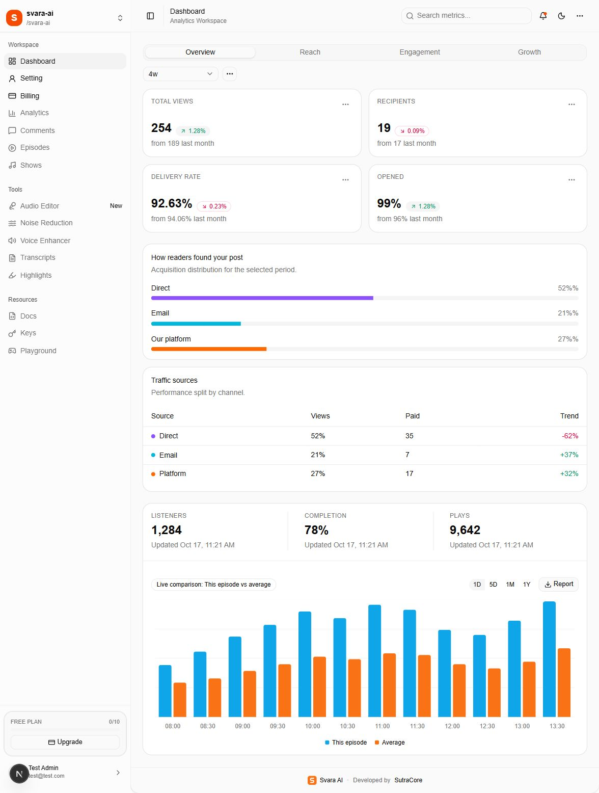

# Svara AI — Final Release

Prepared: **31 October 2026** · Application: **svara-app 0.1.0** · Developer: **SutraCore**

This folder explains how to use, configure, install, and hand over the current application. Screenshots come from the running app at `http://localhost:3000` using the supplied demonstration account. Provider reference screenshots show public documentation, not a configured customer account.

**Open [final-release.html](final-release.html) for the complete illustrated guide in a browser.** It works offline and embeds its screenshots. The individual Markdown documents below are the editable source.



## Read in this order

| Document | Audience | What it explains |
| --- | --- | --- |
| [01 — Authentication](01-authentication.md) | All users | Sign-in, registration, email verification, recovery, two-factor sign-in, and first-time onboarding |
| [02 — Workspaces](02-workspaces.md) | Workspace owners and administrators | Switching, creating, editing, invitations, and plan limits |
| [03 — Dashboard](03-dashboard.md) | All users | Navigation, cards, charts, filters, and current sample content |
| [04 — Settings panel](04-settings-panel.md) | All users and administrators | Each of the eight settings panels, explained separately |
| [05 — Stripe configuration and billing](05-stripe-configuration.md) | Installer and billing owner | API keys, prices, webhooks, portal, test mode, and customer billing |
| [06 — Environment, Cloudflare, and email](06-environment-and-services.md) | Installer | Every runtime environment variable, where to obtain it, R2, Resend, and database configuration |
| [07 — Installation and ZIP release](07-installation-and-zip-release.md) | Installer and delivery team | Packaging source, extracting it, installing, initializing a new database, starting, and backups |
| [08 — Launch checks and troubleshooting](08-launch-checks-and-troubleshooting.md) | Delivery team and support | Acceptance checklist, current limitations, and practical recovery steps |
| [09 — Branding and app configuration](09-branding-and-app-configuration.md) | Customer developer and installer | Logo, brand name, colors, icons, email branding, SEO, navigation, plans, and other settings |
| [10 — Error pages and listing demos](10-error-pages-and-listings.md) | Developers and reviewers | Error/maintenance previews, grid listings, and synthetic remote-table pagination |

Each document includes a **Code examples and source locations** section. Code excerpts explain the implementation or show a clearly labelled customization example. They are not changes already applied to the running app, and snippets that use existing handler variables belong inside the named source file rather than being run in a terminal.

## Files supplied

This public documentation includes guides, screenshots, a logo, and a placeholder environment template. The executable helper scripts described below are supplied with the purchased application source package; commands that reference them are run from that application root.

- `screenshots/`: original browser captures used in the documents.
- `config/.env.example`: placeholder-only configuration; copy it to the application root as `.env` and fill in customer-owned credentials.
- `scripts/create-release.ps1`: packages current source and docs into a ZIP, excluding dependencies, generated output, credentials, and local development files.
- `scripts/initialize-plans.sql`: inserts the three default plan definitions into a **new** initialized database.
- `scripts/build-guide.cjs`: rebuilds the HTML reader from these Markdown documents using the installed `marked` and `sharp` modules (`node docs/scripts/build-guide.cjs` from the app root).
- `scripts/verify-docs.cjs`: checks local document links and screenshot references.

## Release boundary

The source ZIP contains application code and documentation. PostgreSQL records, R2 uploads, external service accounts, Stripe subscriptions, and real credentials are separate assets. Copying the app folder does not copy those services. Give the customer access to their hosting, DNS, database, Cloudflare, Resend, and Stripe accounts through the providers' normal account-management tools.

The supplied test login is for this demonstration environment. It is not created automatically in a fresh database. The application currently displays demonstration credentials on its public authentication pages; remove that content and the test prefills before production delivery. See the launch notes in document 08.

The live review confirmed navigation and page contents. It did not send invitations or OTP emails, change passwords, register security keys, modify paid subscriptions, delete records, or deploy the application. Onboarding is described from source because this account has already completed it. Source findings and outstanding launch checks are explicitly identified throughout the guide.

## Code examples and source locations

Run the following from the application root after editing these Markdown documents:

```powershell
# Generate the illustrated offline reader from docs/*.md.
node .\docs\scripts\build-guide.cjs

# Check screenshots, code sections, links, and environment coverage.
node .\docs\scripts\verify-docs.cjs

# Package current source and documentation; this prints the archive location.
.\docs\scripts\create-release.ps1
```

For customer branding, begin with document 09 and the source files below:

```text
public/assets/logo.svg                    Main square brand mark
lib/seo.ts                                Shared name, metadata, developer, theme color
components/common/brand-logo.tsx           Visible auth wordmark and logo alt text
app/globals.css                           Light/dark UI color tokens and typography
scripts/generate-brand-assets.mjs          Generated favicon, Apple, and app icons
emails/email-layout.tsx                    Shared email branding and inline styles
app/opengraph-image.tsx                    Social-share image layout and wording
```
