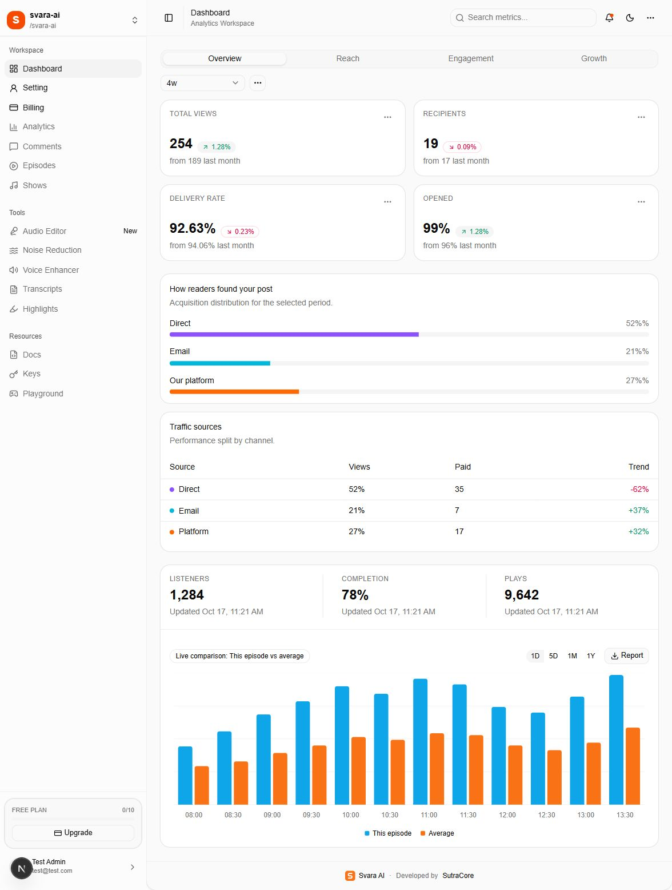
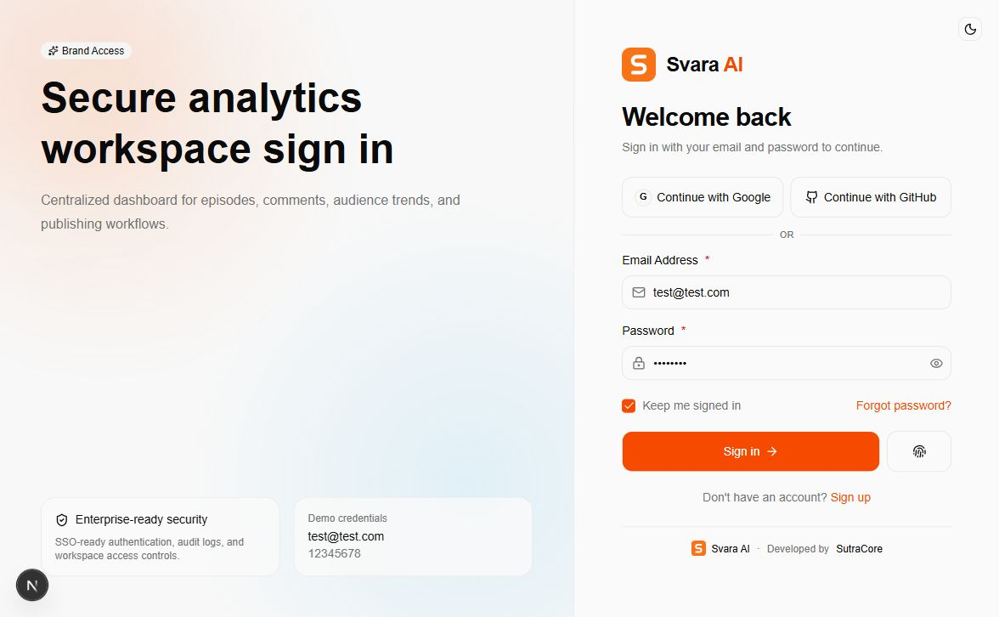
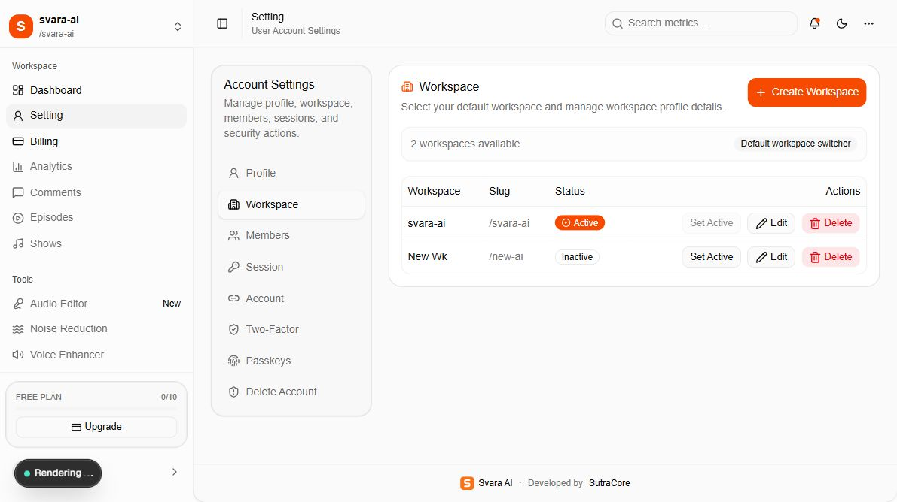
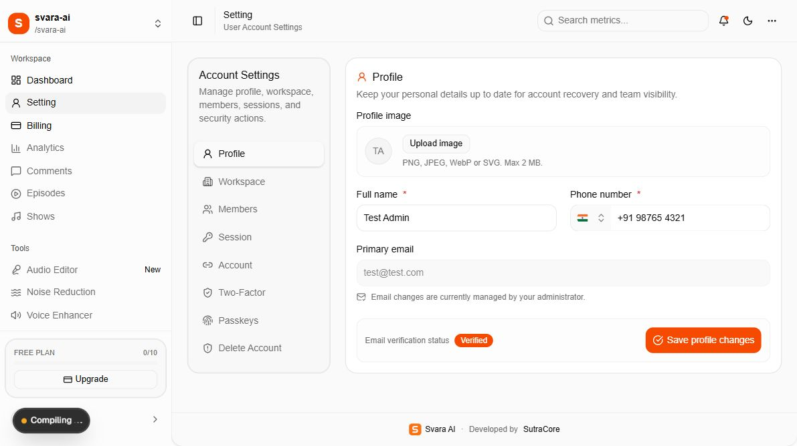
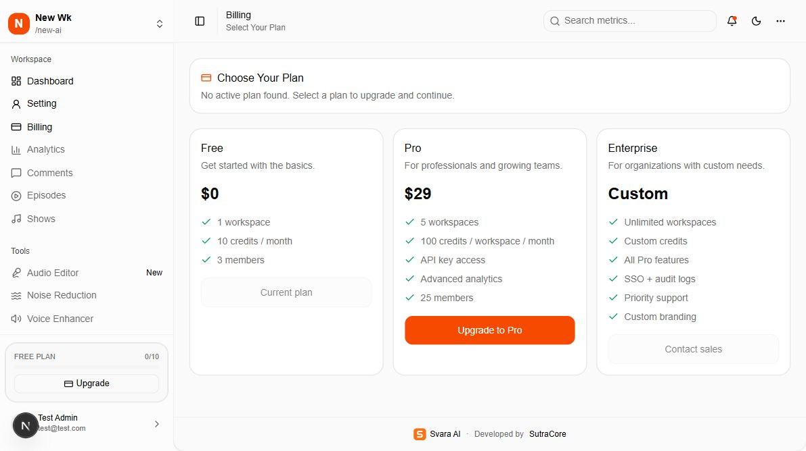
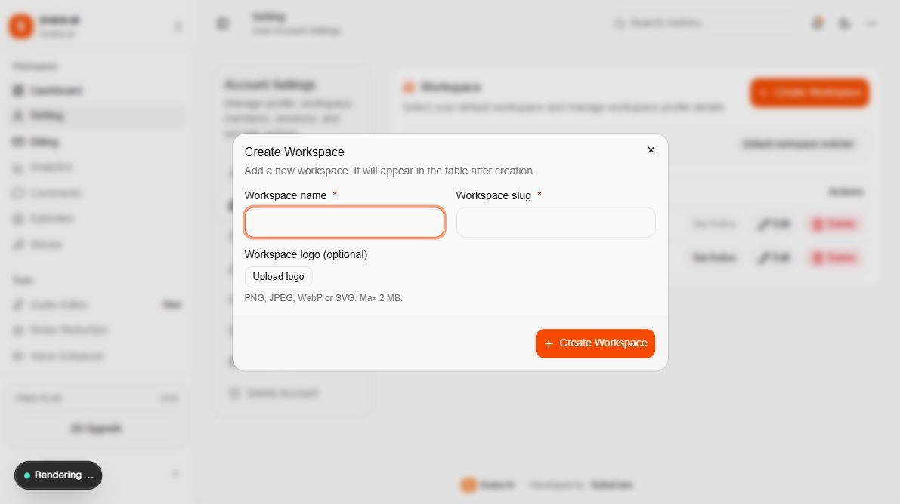
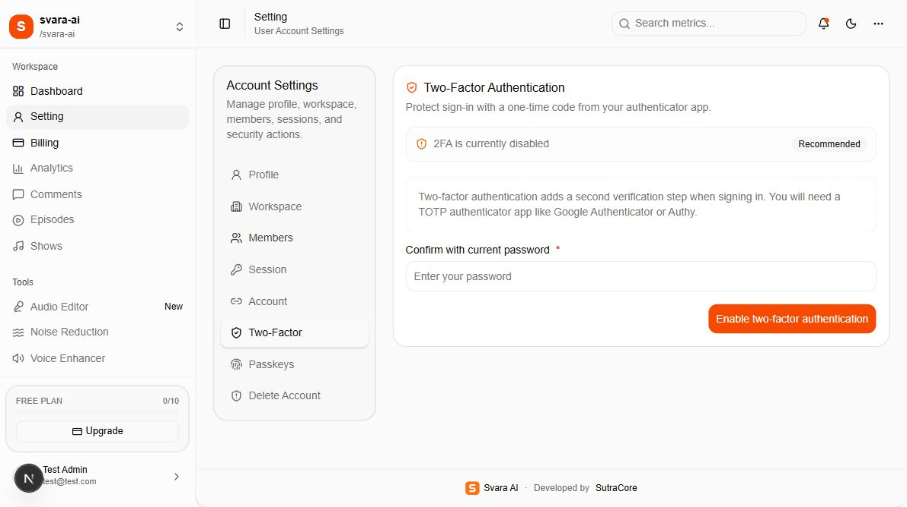

<p align="center">
  
</p>

<h1 align="center">Svara AI</h1>

<p align="center">
  <strong>Final Release</strong><br />
  A customizable workspace dashboard for audio creators, teams, and SaaS products.<br />
  Developed by <a href="https://www.sutracore.com/">SutraCore</a>.
</p>

<p align="center">
  <a href="https://dashboard.sutracore.com"><strong>Live Demo</strong></a>
  &nbsp;·&nbsp;
  <a href="#screenshots">Screenshots</a>
  &nbsp;·&nbsp;
  <a href="#features">Features</a>
  &nbsp;·&nbsp;
  <a href="#documentation">Documentation</a>
  &nbsp;·&nbsp;
  <a href="https://www.sutracore.com/work/svara"><strong>Download / Buy</strong></a>
  &nbsp;·&nbsp;
  <a href="#license">License</a>
</p>

## Overview

Svara AI brings account management, team workspaces, subscription billing, and an analytics dashboard interface into one Next.js application. It includes email verification and recovery flows, workspace and member settings, session management, passkey and two-factor interfaces, and a customizable light/dark theme.

The source package includes an illustrated **Final Release** guide with setup instructions, provider configuration, code examples, and a map of the files to edit for a customer rebrand.

| Resource | Link |
| --- | --- |
| Live application demo | [dashboard.sutracore.com](https://dashboard.sutracore.com) |
| Product, source download, and purchase | [Svara AI on SutraCore](https://www.sutracore.com/work/svara) |
| Public GitHub page | [sutracore/svara-dashboard](https://github.com/sutracore/svara-dashboard) |
| Final Release documentation | [Documentation index](INDEX.md) |
| Complete offline guide | [final-release.html](final-release.html) — download and open in a browser |
| Licensing information | [License](#license) |

## Live Demo

**[Open the Svara AI demo →](https://dashboard.sutracore.com)**

The sign-in page lists the demonstration credentials. Explore the dashboard, workspace selector, settings panels, and billing screens. The source documentation describes each page and its configuration requirements.

## Download and Buy

**[Download source code / Buy Svara AI →](https://www.sutracore.com/work/svara)**

Visit the official product page to review the current offer, purchase details, and how to obtain the source package. Download and purchase links in this README both lead to that page. Confirm the included delivery/support scope and license terms with SutraCore there.

## Screenshots

These captures show the supplied demonstration application. Example account details, dates, plan records, and analytics figures illustrate the interface; they are not live customer reports.

### Dashboard overview



### Sign-in and workspace management

| Authentication | Workspace settings |
| --- | --- |
|  |  |
| Email/password sign-in, recovery links, and passkey entry point. | Workspace name, slug, active status, and management controls. |

### Account settings and billing

| Profile settings | Plan selection |
| --- | --- |
|  |  |
| Profile image, name, mobile number, and email-verification status. | Customer plan cards and the Pro upgrade entry point. |

### Workspace creation and security

| Create workspace | Two-factor settings |
| --- | --- |
|  |  |
| Workspace name, slug, and optional logo in a dedicated form. | Authenticator setup/status interface for account security. |

More screenshots are attached to the individual [Final Release guides](INDEX.md).

## Features

| Area | Included in this source version |
| --- | --- |
| Authentication | Email/password registration and sign-in, email OTP verification, password recovery, and protected workspace routes |
| Account security | Passkey and TOTP two-factor interfaces, active-session review/revocation, linked-account display, and account-deletion controls |
| Workspaces | Create, edit, and switch workspaces; manage workspace names, slugs, and logos |
| Team access | Invite members with roles, view members, and review/cancel pending invitations |
| Billing | Stripe subscription integration, Pro Checkout entry point, billing portal access, and webhook-driven allowance hooks |
| Plans and allowances | Free, Pro, and Enterprise definitions for credits, workspace limits, member limits, and feature identifiers |
| Image storage | Cloudflare R2 uploads for profile pictures and workspace logos |
| Transactional email | Resend delivery for verification/recovery OTPs and workspace invitations |
| Interface | Responsive dashboard layout, sidebar navigation, light/dark appearance, cards, tables, and comparison charts |
| Branding | Shared logo assets, generated favicon/app icons, metadata, email layouts, and documented color/name customization |
| Documentation | Illustrated guides, code examples, an environment template, and source-packaging instructions |

**Current scope:** overview analytics use sample data; Reach, Engagement, and Growth are placeholders. Several audio/developer sidebar tools are disabled, and Google/GitHub sign-in requires server provider configuration. Review [launch checks and current limitations](08-launch-checks-and-troubleshooting.md) for the exact source-version scope and outstanding checks before deployment.

## Technology Stack

| Layer | Technology |
| --- | --- |
| Application | Next.js 16, React 19, TypeScript |
| UI and styling | Tailwind CSS 4, shadcn/Base UI components, Lucide icons |
| Authentication | Better Auth with organization, email OTP, passkey, two-factor, and Stripe integrations |
| Database | PostgreSQL with Drizzle ORM |
| Billing | Stripe |
| File storage | Cloudflare R2 through the S3-compatible API |
| Email | Resend and React Email |
| Charts | Recharts |
| Package management | Bun and the checked-in `bun.lock` |

## Documentation

Start with the **[Final Release documentation index](INDEX.md)**. Each guide includes screenshots, code examples, and source-file locations.

| Guide | What it covers |
| --- | --- |
| [01 — Authentication](01-authentication.md) | Sign-in, registration, email verification, password reset, passkeys, two-factor sign-in, and onboarding |
| [02 — Workspaces](02-workspaces.md) | Workspace selection, creation, editing, member invitations, roles, and limits |
| [03 — Dashboard](03-dashboard.md) | Navigation, metric cards, charts, date controls, and sample-data scope |
| [04 — Settings panel](04-settings-panel.md) | Profile, Workspace, Members, Session, Account, Two-Factor, Passkeys, and Delete Account |
| [05 — Stripe configuration](05-stripe-configuration.md) | Server keys, recurring prices, webhook events, customer portal, and test/live configuration |
| [06 — Environment and services](06-environment-and-services.md) | Every runtime environment variable; where to obtain PostgreSQL, Cloudflare R2, Resend, and Stripe values |
| [07 — Installation and ZIP release](07-installation-and-zip-release.md) | Source packaging, extraction, dependency installation, new-database setup, startup, and data migration |
| [08 — Launch checks and troubleshooting](08-launch-checks-and-troubleshooting.md) | Acceptance checks, current limitations, common errors, and support information |
| [09 — Branding and configuration](09-branding-and-app-configuration.md) | Logo, brand name, colors, icons, email branding, SEO, navigation, plan settings, and upload limits |
| [10 — Error pages and listing demos](10-error-pages-and-listings.md) | Error/maintenance previews, grid listings, and the synthetic remote-table demo |
| [10 — Error pages and listings](10-error-pages-and-listings.md) | Error and maintenance previews, paginated episode grid, and a remote table with 10 million synthetic records |

The [offline HTML guide](final-release.html) embeds its screenshots and supports **Print / Save as PDF**. GitHub displays HTML source files as repository content; download the file and open it locally for the formatted reader.

## Code examples and source locations

### Getting started after purchase

Follow these steps **after obtaining the application source package** from the [official product page](https://www.sutracore.com/work/svara).

Use a Node.js version compatible with Next.js 16 (20.9 or newer), Bun, and PostgreSQL. Docker is optional for the bundled local database setup.

From a freshly extracted application folder:

```powershell
# Install from the supplied lockfile.
bun install --frozen-lockfile

# Create local configuration from placeholders.
Copy-Item -LiteralPath '.\docs\config\.env.example' -Destination '.\.env'
```

Fill in `.env` using the [environment and service guide](06-environment-and-services.md). Configure the database and initialize missing plan records using the [installation guide](07-installation-and-zip-release.md) before creating the first workspace. Email verification needs a configured Resend sender; image uploads need R2; paid billing needs Stripe.

Start development after setup:

```powershell
bun run dev
```

Open [localhost:3000/auth/signin](http://localhost:3000/auth/signin). A fresh database requires a newly registered and verified account; the demonstration account is not seeded automatically.

For a configured production deployment:

```powershell
bun run build
bun run start
```

Use the hosting provider's HTTPS, environment, process-management, and database-backup setup. Keep actual `.env` credentials outside public Git history and source release archives.

## Branding and Configuration

The [branding guide](09-branding-and-app-configuration.md) explains each rebrand location, including values outside the shared config.

| Change | Start here |
| --- | --- |
| Main square logo | `public/assets/logo.svg` |
| Visible auth wordmark | `components/common/brand-logo.tsx` |
| Shared name, description, developer credit, and theme color | `lib/seo.ts` |
| UI colors, light/dark tokens, typography, and radius | `app/globals.css` |
| Favicon, Apple touch icon, and installed-app icons | `scripts/generate-brand-assets.mjs` |
| Email header/footer and inline styling | `emails/email-layout.tsx` and individual message templates |
| Public SEO origin | `NEXT_PUBLIC_SITE_URL` in the build environment |
| Social-share image | `app/opengraph-image.tsx` |
| Workspace-specific name and logo | **Setting → Workspace** |

After updating the source logo and generator colors, regenerate the derived icons:

```powershell
bun run brand:generate
```

Changing a workspace name/logo affects that team's database record. Application branding, browser icons, email branding, and social previews have their own source settings.

## License

Svara AI is offered as a **commercial source-code product by SutraCore**.

**[Purchase and licensing information →](https://www.sutracore.com/work/svara)**

Confirm license scope, permitted use, redistribution terms, and support details with SutraCore through the official product page. This checkout does not declare an open-source license for the application. Third-party dependencies retain their respective licenses.

## SutraCore

Built by **[SutraCore](https://www.sutracore.com/)**.

[Try the demo](https://dashboard.sutracore.com) · [Download / Buy Svara AI](https://www.sutracore.com/work/svara) · [Documentation](INDEX.md) · [License](#license)
